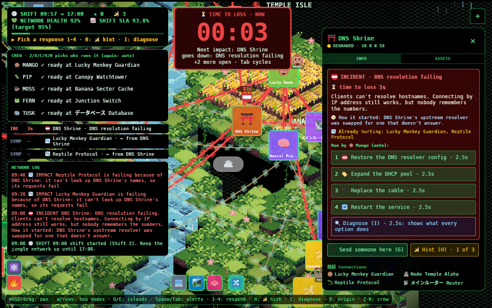
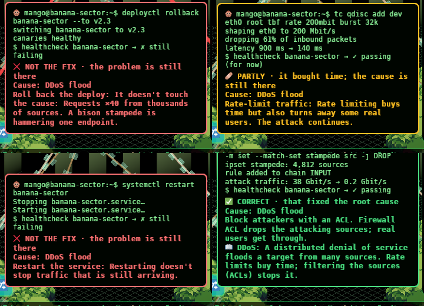
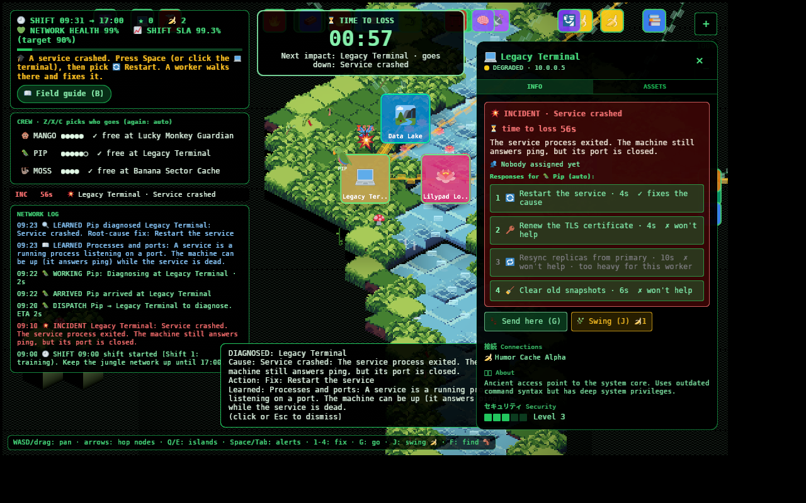
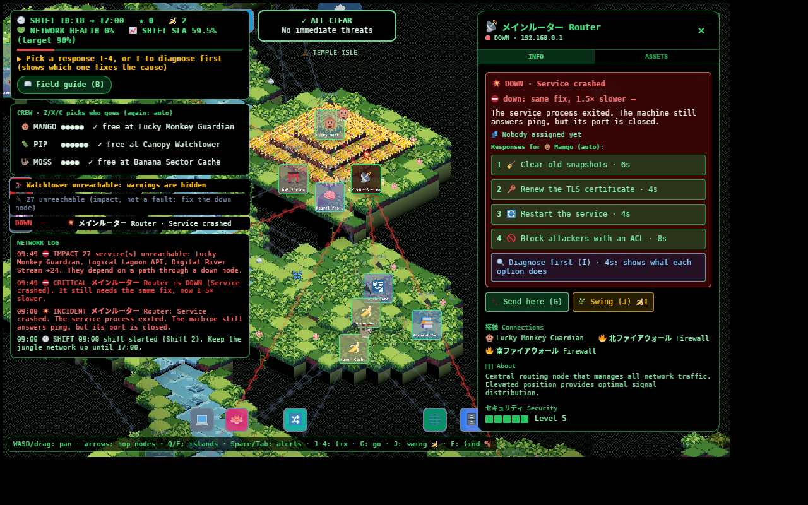

<div align="center">

# 🐵 Lucky Monkey: On-Call in the Jungle

**A browser game about keeping a make-believe jungle network alive through one on-call shift.**
Routers are temples, firewalls are vine gates, the database lives in a lake, and the outages are real ones in costume.

[](https://go.fridge.run/luckymonkey)
[](https://go.fridge.run/luckymonkey#shift)


</div>

> *It is 09:00. You are on call. A stampede of bison is about to hit the Banana
> Cache, a worm is reaching across the vines, and the certificate on the Auth
> Gate expires in fifty seconds. The Watchtower can see some of it coming. Not
> all of it.*

---

## 📚 Contents

- [🎮 How to play](#-how-to-play)
- [🧠 What it teaches](#-what-it-teaches)
- [⚙️ How the game code works](#️-how-the-game-code-works)
- [🛠️ Build and run it yourself](#️-build-and-run-it-yourself)
- [✏️ Change the game without recompiling](#️-change-the-game-without-recompiling)
- [📖 Documentation](#-documentation)
- [🙏 Credits and licences](#-credits-and-licences)

---

## 🎮 How to play


You run a small crew through an 8-minute shift (09:00 → 17:00 on the game clock).
Things break. You read the symptoms, send someone, pick the response, and race the
**⏳ Time to Loss**.

### 1. Learn the network first. Nothing breaks until you start.

| Key | Mode | |
|---|---|---|
| **T** | 🗺️ **Tour** | Island by island through all 28 nodes: what each one *is*, its lore, what it links to, and how many services lose their path if it goes down |
| **P** | 🧪 **Practice** | One problem at a time, timers ×3, nothing spreads, no game over |
| **B** | 📖 **Field guide** | Every concept you've met, with the example where you met it |


### 2. Delegate to your crew

| | | Faster at | Can't |
|---|---|---|---|
| 🐵 | **Mango** the monkey | good at everything | |
| 🦜 | **Pip** the parrot | diagnosis | heavy work |
| 🦥 | **Moss** the sloth | maintenance: certs, patches, canaries | |
| 🐸 | **Fern** the tree frog | hardware: cables, vents, power | |
| 🐘 | **Tusk** the elephant | heavy work: rollbacks, hotfixes, replicas | |

Pick a response and a crew member **runs it straight away**, in about 2.5 s. They
still travel to the node on the map, but nothing waits for them. Each runs one
thing at a time, so the whole crew can work five problems at once.

### 3. Find the origin, not the symptoms



Every problem **starts somewhere for a reason** (*"A botnet of a million bison found
the Banana Cache on the open internet"*) and, left alone, **spreads along its
links** as its timer runs down.

- 🟡 **Warning**: nothing is broken yet. Prevent it (renew the cert, canary the deploy) for bonus points.
- 🔴 **Incident**: the origin. It's degraded and counting down; at 0 it goes **down**.
- 📉 **Symptom**: a neighbour suffering from it. Nothing to fix there: **O** jumps to the origin, and fixing the origin clears every symptom at once.
- 🐛 **Worms** are contagious: they infect neighbours for real.
- 🩶 **Unreachable**: fine, but cut off because the only path runs through a down node.

### 4. Run the command, read the verdict



Pick one of four responses. The terminal types the real command, streams its
output, runs a health check, and then says **✅ CORRECT**, **🩹 PARTLY** (it bought
time) or **❌ NOT THE FIX**, with the reason. Not sure? 🍌 **H** spends a banana on a
hint, or 🔍 **I** diagnoses every option.



### 5. Keep the SLA

**Network health** is the network right now. **Shift SLA** is its average over the
shift, and you need **95%** to pass and unlock the next level. At the end you get
your score, ✅ what went right, ⚠️ what went wrong (with specifics such as *"メインルーター Router went down
when its Time to Loss ran out, cutting off 27 other service(s)"*), and your shift history.


### ⌨️ Keys

`Enter` start · `Space` most urgent · `Tab` cycle problems · `1-4` respond · `I` diagnose ·
`H` 🍌 hint · `O` go to the origin · `Z X C V N` pick a crew member · `G` send ·
arrows hop nodes · `Q/E` islands · `WASD`/drag pan · wheel/pinch zoom · `F` follow

📱 On a phone: drag, pinch, tap a node, tap a response. Off-screen nodes become
**pins on the screen edge**. Tap one to fly there.

▶ **Jump straight into a situation:**
[DDoS on the Banana Cache](https://go.fridge.run/luckymonkey#node=banana-sector&incident=ddos&zoom=1.2) ·
[a deploy that migrated the database](https://go.fridge.run/luckymonkey#node=main-router&incident=migration) ·
[a certificate about to expire](https://go.fridge.run/luckymonkey#node=auth-gate&forecast=cert&zoom=1.3) ·
[DNS down](https://go.fridge.run/luckymonkey#node=dns-shrine&incident=dns&zoom=1.4)

Full rules: **[docs/gameplay.md](docs/gameplay.md)**

---

## 🧠 What it teaches

Under the jungle paint, every fault is a real production failure and every right
answer is the first move an experienced operator would make.
**[All 18 fault types →](docs/failures.md)**

| In the jungle | In real life |
|---|---|
| 💥 Service crashed → 🔄 restart | a process can die while the machine still answers ping |
| 📛 Names don't resolve, IPs work → fix DNS | the classic *"it's always DNS"* |
| 🏷️ New devices get no address → expand the DHCP pool | address exhaustion |
| 🦬 Stampede on one endpoint → block with an ACL (rate-limit only buys time) | DDoS: mitigation vs remediation |
| 📉 Neighbours failing because of one broken node → fix the origin, not the symptoms | root cause and blast radius |
| 🐛 Worm → patch (quarantine only buys time) | containment vs eradication |
| 📦 Bad deploy → **roll back**; with a schema migration → **fall forward** | when rollback is and isn't safe |
| ⚖️ Replicas disagree → resync from the primary | replication lag and split brain |
| 🔁 Routing loop, 📢 broadcast storm (→ Spanning Tree), 🏝️ wrong VLAN | layer 2 and 3 failure modes |
| 🔐 Expiring certificate → renew it. "Disable TLS" is refused, with the reason | security isn't optional under pressure |
| 🩶 Router down → 27 services *unreachable* | root cause vs dependency impact, blast radius |
| 📅 🧬 💾 warnings | proactive vs reactive work: prevention is cheaper |
| ⏳ Time to Loss | prioritising by consequence, not by noise |

It also teaches the *shape* of on-call: triage, delegating to people with
different strengths, not burning out your crew, and reading the symptom before
grabbing a tool. "Time to Loss" is the game's own term, and the field guide is
explicit that it is **not** IP TTL or DNS TTL.

---

## ⚙️ How the game code works

```
 game/data/*.json ──▶ data.rs ──▶ sim.rs (the rules: no Bevy, fully testable)
   tuning · islands ·              ▲   │ health, faults, crew, director, log
   nodes · world · npcs            │   ▼
                    keys/clicks ─ ops.rs (HUD, Time to Loss, overlays, pins, input → orders)
                                   │
           world.rs · water.rs · clouds.rs · npc.rs · view.rs · ui.rs   (Bevy ECS: drawing)
```

- **[Bevy](https://bevyengine.org) 0.20, Rust → WebAssembly → WebGL2.** One isometric
  projection function, one terrain mesh per diagonal row so depth sorting is exact,
  a texture atlas for the tiles. → [docs/engine.md](docs/engine.md), [docs/world.md](docs/world.md)
- **`sim.rs` is the whole game model, with no engine.** Each frame the screen calls
  `Sim::step(dt)` and draws the result. A separate native crate, `game/simtest/`,
  compiles the *same file* and runs 14 rule tests plus a balancing harness with bot
  players (Idle / Novice / Beginner / Expert × 4 levels × 20 seeds).
  → [docs/simulation.md](docs/simulation.md)
- **Health is a graph walk.** After every change a breadth-first search from the core
  router marks what's reachable. Anything cut off is *Unreachable*, so root causes and
  impacts never get mixed up.
- **An incident director** deals new trouble only after a grace period, under a
  per-level budget, and never while the network is already on its knees.
- **Workers** route over the links with Dijkstra (flyers go straight). The game
  picks whoever would *finish* first unless you choose.
- **One event log** groups related events ("27 services unreachable" is one line, not 27).
- **The map is data.** `tools/gen-world.py` turns `islands.json` + `nodes.json` into the
  archipelago: one river from void to void, canyons where islands rise above it,
  vine bridges, free-floating islands, hanging pixel vines.



| File | What |
|---|---|
| [`game/src/sim.rs`](game/src/sim.rs) | rules: faults, responses, director, crew, routing, health, SLA, scoring, event log |
| [`game/src/ops.rs`](game/src/ops.rs) | the game screen: HUD, Time to Loss, roster, alerts, log, rope links, edge pins, tour, summary, input |
| [`game/src/ui.rs`](game/src/ui.rs) | welcome gate, node panel |
| [`game/src/world.rs`](game/src/world.rs) | terrain meshes, vines, decorations, node cards |
| [`game/src/water.rs`](game/src/water.rs) · [`clouds.rs`](game/src/clouds.rs) · [`npc.rs`](game/src/npc.rs) | waterfall, bubbles, data frames · clouds, rain, lightning · wandering critters |
| [`game/src/view.rs`](game/src/view.rs) · [`link.rs`](game/src/link.rs) | camera, touch, picking · deep links (`#node=…&incident=…`) |
| [`game/src/data.rs`](game/src/data.rs) | loads live JSON, merges over built-in copies, never crashes on a bad file |
| [`game/simtest/`](game/simtest) | native tests + balancing bots |
| [`tools/`](tools) | world generator, doc generator, texture packer, font subsetter, build scripts |

---

## 🛠️ Build and run it yourself

```sh
rustup target add wasm32-unknown-unknown
cargo install wasm-bindgen-cli --version 0.2.129 --locked   # must match game/Cargo.lock
tools/build-web.sh                     # builds into web/game
python3 -m http.server -d web 8080     # open http://localhost:8080
```

Run the rules tests and the balancing table (native, no browser needed):

```sh
cd game/simtest
cargo test --release
cargo run --release --bin balance
```

A release build needs a few GB of disk and takes a while the first time (Bevy is
big). The live site also runs inside a small Next.js host page (`app/page.tsx`).
`tools/deploy.sh` is the author's own deploy to their server.

---

## ✏️ Change the game without recompiling

Everything worth tuning is JSON in [`game/data/`](game/data), fetched when the page loads:

| File | Holds |
|---|---|
| [`tuning.json`](game/data/tuning.json) | every fault, response, action, crew member, level, the training script, concepts, numbers |
| [`islands.json`](game/data/islands.json) | the archipelago: islands, heights, hills, river, bridges |
| [`nodes.json`](game/data/nodes.json) | the 33 nodes: names, emoji, connections, lore |
| `world.json` | generated from the two above by `tools/gen-world.py` |

Edit, run `python3 tools/gen-world.py` (if you touched the map), copy into
`web/game/data/`, and reload. A broken file falls back to the built-in copy, so a
typo can't take the game down. Add a fault in JSON and it's in the game, in the
docs (`tools/gen-docs.py`), and in the deep links.

---

## 📖 Documentation

| | |
|---|---|
| 🎮 [How to play](docs/gameplay.md) | rules, crew, levels, keys |
| 💥 [Failure types](docs/failures.md) | all 18 faults: symptom, fix, mitigation, why (generated from the data) |
| 🏝️ [Nodes and lore](docs/nodes.md) | the legend, every island and node, its role and story (generated) |
| 🧮 [The simulation](docs/simulation.md) | the model, director, workers, tests and balancing numbers |
| 🎯 [On-call design](docs/oncall-design.md) | why the loop works the way it does |
| 🖥️ [Interface](docs/interface.md) | layout, phone layout, camera, deep links, Bevy UI traps |
| 🌋 [The world](docs/world.md) | isometric maths, terrain, the archipelago, water, clouds |
| 🦀 [The engine](docs/engine.md) | Bevy and ECS, explained for this project |
| 🔧 [Build, deploy and test](docs/build-deploy.md) · [Extending](docs/extending.md) | |
| 🖼️ [A tour in pictures](docs/tour.md) · [Overview and history](docs/overview.md) · [Decisions](docs/decisions.md) · [Glossary](docs/glossary.md) | |
| 📦 [Outside assets and licences](docs/assets.md) · [Isometric engine extraction report](docs/extraction-report.md) | |

---

## 🙏 Credits and licences

- **Engine:** [Bevy](https://bevyengine.org) (MIT/Apache-2.0) and the Rust crates listed in [docs/assets.md](docs/assets.md).
- **Emoji:** [Twemoji](https://github.com/jdecked/twemoji) graphics © Twitter / X Corp. and contributors, **CC-BY 4.0**, in the [Twemoji Mozilla](https://github.com/mozilla/twemoji-colr) colour font build.
- **Fonts:** [DejaVu Sans Mono](https://dejavu-fonts.github.io) (Bitstream Vera licence) and [Noto Sans Mono CJK JP](https://github.com/notofonts/noto-cjk) subset (SIL OFL 1.1).
- **Tile sprites and grid background:** from the project's original [v0.dev](https://v0.dev) prototype. Their provenance wasn't recorded; see [docs/assets.md](docs/assets.md).

Made by **[LuckyMonkey](https://github.com/LuckyMonkey)** 🐒🍌
