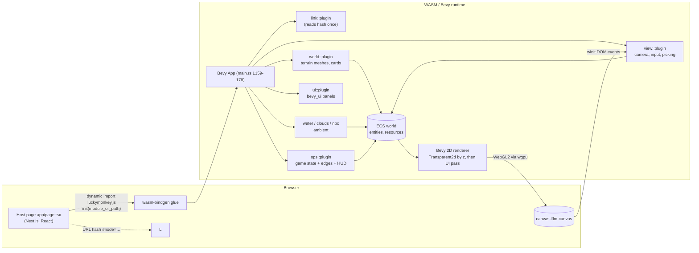
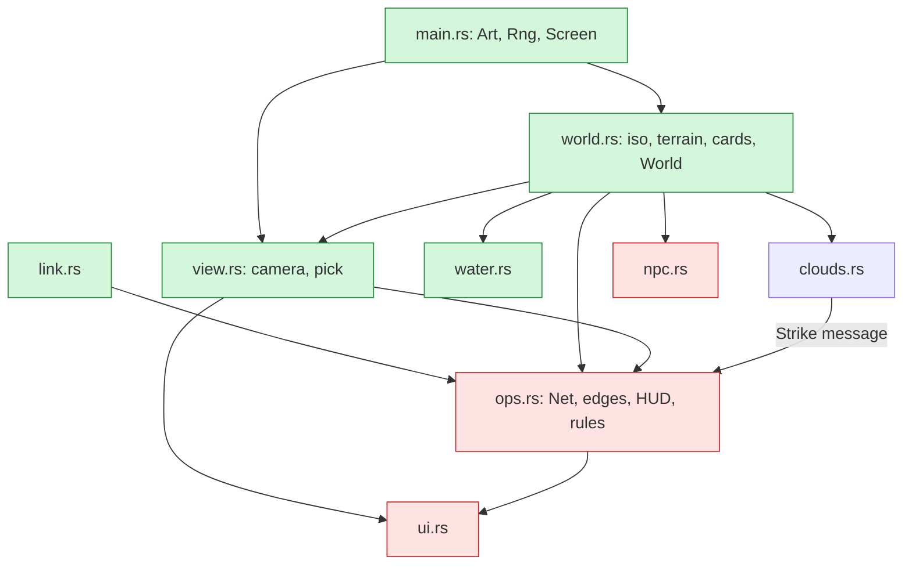
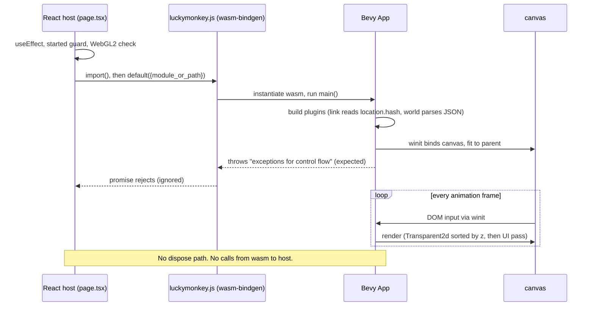
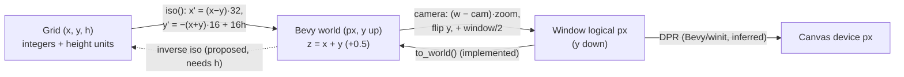
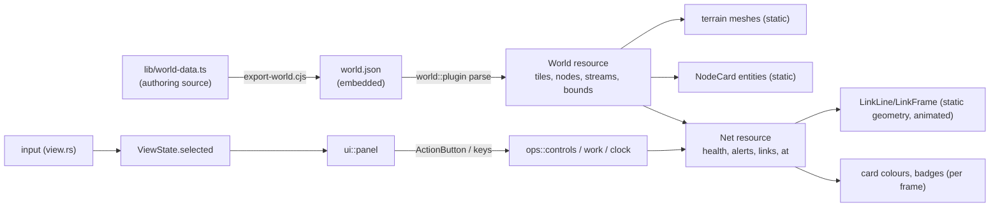
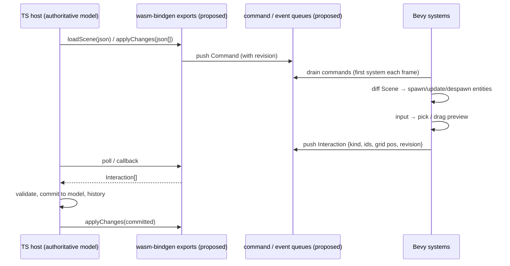
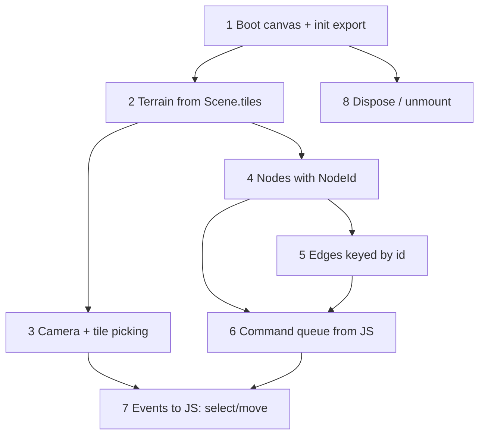

# Isometric Engine Extraction Report: Lucky Monkey (Bevy 0.20 / WebAssembly)

**Answer to:** `bevy.md` (Codex agent task, "Bevy/WASM Isometric Engine Extraction Report")
**Repository:** `LuckyMonkey/luckymonkey` (private GitHub), local clone `~/Projects/luckymonkey` on freezer
**Audited commit:** `88608ff` (2026-10-15), "Deep links: the URL hash opens the game at a node with an optional staged incident"
**Live build:** <https://go.fridge.run/luckymonkey>
**Companion docs:** wiki `git:luckymonkey:docs:*` (same text as this file: `docs/extraction-report.md`)

**Evidence labels used throughout:**
- **Implemented**: present in the code at the cited path and lines.
- **Inferred**: follows from Bevy/engine behaviour, not from code in this repo.
- **Proposed**: new design for the recipient; nothing like it exists.
- **Not found**: searched for and absent.

All line numbers refer to commit `88608ff`.

**What was actually run while preparing this report:**
- `tools/deploy.sh build`: a release build for `wasm32-unknown-unknown` on the build host "fridge", then wasm-bindgen. It succeeded.
- `tools/deploy.sh`, which deployed the audited commit.
- Headless Firefox playthroughs (`tools/browser-test.sh` and deep-link captures) against the local and live builds. No panics.
- Measurement of the served wasm size.

**Not run:** no benchmarks, no unit tests (none exist), no profiling.

---

## 1. Executive technical summary

**How it renders.** A single Bevy 0.20 `App` compiled to `wasm32-unknown-unknown` attaches to an existing `<canvas id="lm-canvas">`. It draws with Bevy's 2D renderer over WebGL2 (wgpu GL backend), using **one orthographic `Camera2d`**.

**Terrain** is generated once at startup from embedded JSON:
- Grid cells are grouped by isometric diagonal row (`x + y`).
- Each row becomes **one `Mesh2d`** placed at `z = x + y`. It contains the textured top quads (from a 136×136 tile atlas, nearest filtering) and vertex-coloured side walls.
- Depth is handled entirely by **z-ordering in the 2D transparent phase**: higher z draws later.
- Code: `game/src/world.rs` `spawn_terrain` L297-348.

**Everything else** is ordinary Bevy entities:
- Node "cards" are `Sprite` + `Text2d` children.
- Decorations and critters are emoji `Text2d`.
- Edges are a rotated 2 px `Sprite` plus streams of small "frame" sprites.
- Clouds are sprites.
- The HUD and panels are `bevy_ui`.

**Toolchain (implemented, evidenced):**

| Item | Value | Evidence |
|---|---|---|
| Rust edition | 2024 | `game/Cargo.toml` L4 |
| Bevy | **0.20.0** (`default-features = false`; features `default_app std web webgl2 bevy_winit default_font 2d_api 2d_bevy_render ui_api ui_bevy_render png mouse touch keyboard`) | `game/Cargo.toml` L9-13; `game/Cargo.lock` |
| wgpu / winit / taffy / glam | 30.0.1 / 0.30.13 / 0.14.0 / 0.33.12 | `game/Cargo.lock` |
| wasm-bindgen (crate and CLI) | 0.2.129 (must match) | `game/Cargo.lock`; `tools/deploy.sh` L19-21 |
| web-sys | 0.3.106, features `Window`, `Location` (wasm32 only) | `game/Cargo.toml` L19-21 |
| serde / serde_json | 1.0.229 / 1.0.154 | `game/Cargo.lock` |
| rand / getrandom | 0.9.5 / 0.3.4: **declared but unused** (custom `Rng` in `main.rs` L63-75) | `game/Cargo.toml` L16-17 |
| Build target | `wasm32-unknown-unknown`, `wasm-bindgen --target web --no-typescript` | `tools/deploy.sh` L19-21 |
| Release profile | `opt-level="s"`, thin LTO, 1 codegen unit, strip, `panic="abort"` | `game/Cargo.toml` L23-28 |
| Rust toolchain on build host | rustup stable (cargo 1.99), `~fridge/.cargo` | build host; not pinned in repo (**no `rust-toolchain.toml`**: Not found) |
| Bundler | **none** (no trunk, no webpack for the game); host page uses Next.js 14 only to serve files | `app/page.tsx`; `compose.yml` |

**Major subsystems (all in `game/src/`):**

| File | Role | Coupling |
|---|---|---|
| `main.rs` | Bootstrapping, `Art`, procedural textures, `Rng` | Low |
| `world.rs` | Isometric maths, terrain mesh, decorations, node cards | Low to medium: map-specific fix-ups |
| `view.rs` | Camera, pan/zoom, picking | Low |
| `water.rs`, `clouds.rs`, `npc.rs` | Ambient effects | Medium: map-specific |
| `ui.rs` | Panels | High: domain text |
| `ops.rs` | Game rules, plus edge rendering and node status styling | High; this is the part to split |
| `link.rs` | URL-hash input | Low |

**Reuse potential:** high for the isometric terrain pipeline, the coordinate maths, the camera/picking code, the node card rendering and the edge rendering technique.

**Extraction blockers:**
1. **There is no JS↔WASM API at all**; the only input from the host is the URL hash, read once (`link.rs`).
2. The scene is **static after startup**: terrain and edges are spawned once with no update path.
3. Node identity is a **`usize` index** into a `Vec` (`NodeCard(pub usize)`, `world.rs` L148), not a stable id.
4. Edge rendering lives inside the game module (`ops.rs`) and reads game state (`Net`).
5. There is **no unmount/teardown**: winit owns the browser event loop.
6. Wasm size is **28.6 MB raw, 6.74 MB as served (zstd)**.



**Extract vs rebuild (recommendation):** **extract and adapt**. The reusable visual core is small: about 300 lines of `world.rs`, about 130 of `view.rs`, about 60 of `main.rs`, about 90 of the edge code in `ops.rs`. It is proven to give correct tile overlap, and it is simple (no custom shaders, no third-party tiling crates).

What must be **new** is the host bridge (commands in, events out), dynamic add/update/remove of nodes and edges, stable ids, and teardown. These are additive, not rewrites.

If the recipient's priority is a small bundle, fast startup and DOM accessibility over Bevy's ECS, reimplementing the same maths in a JS 2D renderer is a realistic alternative. The maths and the asset pipeline port directly (see §14).

---

## 2. Repository and dependency inventory

### Curated tree (active paths only)

    luckymonkey/
    ├─ game/                         ACTIVE renderer (Rust crate "luckymonkey", bin)
    │  ├─ Cargo.toml, Cargo.lock
    │  ├─ src/main.rs   179 lines    entrypoint, Art, procedural textures, Rng
    │  ├─ src/link.rs    63          URL-hash deep links
    │  ├─ src/world.rs  487          iso math, terrain mesh, decorations, node cards
    │  ├─ src/view.rs   249          camera, input, picking
    │  ├─ src/water.rs  169          water effects, river frames
    │  ├─ src/clouds.rs 198          clouds
    │  ├─ src/npc.rs    195          critters
    │  ├─ src/ui.rs     506          bevy_ui welcome/panel/zoom
    │  ├─ src/ops.rs   1399          game rules + edges + HUD
    │  └─ assets/                    embedded at compile time (include_bytes!/include_str!)
    │     ├─ tiles.png 136×136, card.png 160×160, card_border.png 160×160
    │     ├─ world.json (117 KB), npcs.json (3 KB)
    │     └─ fonts/ DejaVuSansMono(.ttf, -Bold), NotoSansMonoCJKjp-subset.otf, Twemoji.Mozilla.ttf
    ├─ public/images/grid_background.png 512×512   embedded (backdrop)
    ├─ public/sprites/*.png  15 × 32×32           SOURCE of tiles.png (not loaded at runtime)
    ├─ public/game/          build output (gitignored): luckymonkey.js, luckymonkey_bg.wasm
    ├─ app/page.tsx          host page (canvas + dynamic import)
    ├─ lib/world-data.ts     map SOURCE (TypeScript generators) → world.json
    ├─ lib/npc-data.ts       critter roster SOURCE → npcs.json
    ├─ tools/export-world.cjs, make-textures.py, deploy.sh, subset-fonts.py, browser-test.sh, wiki-source.py
    ├─ art/*.png             UNUSED 1024² illustrations (not served, not loaded)
    └─ docs/                 human documentation

**Shaders:** none in the repo (Not found). Rendering uses Bevy's stock `ColorMaterial`, sprite and UI pipelines.

**Third-party tiling or isometric libraries:** none (Not found). The isometric maths is hand-written (`world.rs` L131-133).

### Legacy and abandoned rendering paths

| Path (git history only) | Status |
|---|---|
| `components/pixi-renderer.tsx` (commit `a10d835`, Pixi.js 2D) | **Abandoned.** Removed in `182ece0`. Had the tile-squash bug (32 px block sprites drawn into 64×32 rects). |
| `components/*.tsx` DOM/CSS renderer (commit `9e35d5d`, v0.dev export) | **Abandoned** baseline |
| Bevy (`game/`) | **Active** |

### Plugin registration and load order (implemented, `main.rs` L159-178)

1. `DefaultPlugins` with a `WindowPlugin` override (canvas `#lm-canvas`, `fit_canvas_to_parent`, `prevent_default_event_handling`, `CompositeAlphaMode::Opaque`).
2. Resources: `ClearColor(BLACK)`, `Rng(0x9e37_79b9_7f4a_7c15)`; state `Screen` (Welcome/Playing, `main.rs` L21).
3. `PreStartup: load_art` (L141-157).
4. Plugins in order: `link`, `world`, `water`, `npc`, `clouds`, `view`, `ui`, `ops`.

`world::plugin` does **synchronous work at plugin build time**: JSON parse, the tile map and bounds (`world.rs` L155-225). This is why `World` is available to every Startup system.

### Module table

| Path | Symbols | Purpose | Dependencies | Reuse grade | Evidence |
|---|---|---|---|---|---|
| `game/src/world.rs` | `iso`, `row_z`, `cell_hash`, `TILE_W/H`, `ELEV`, `BASE`, `Tile`, `World`, `MeshBuf`, `spawn_terrain`, `atlas_cell`, `cell_uv`, `wall_color`, `top_tint` | iso projection and terrain mesh | `Art.tiles` | **A/B** | L17-26, L96-146, L231-348 |
| `game/src/world.rs` | `plugin` fix-ups (dedupe-by-height, pyramid rebuild, river banks) | map-specific data repair | world.json shape | **D/C** | L155-225 |
| `game/src/world.rs` | `spawn_islands`, `spawn_backdrop`, `spawn_decorations`, `deco_emoji`, `emoji_text` | void backdrop, decorations | `Art` | **B** | L350-425 |
| `game/src/world.rs` | `NodeCard`, `spawn_nodes`, `node_color`, `ACCENT` | node cards | `World.nodes` (domain `NodeData`) | **B** | L148, L427-487 |
| `game/src/view.rs` | `ViewState`, `to_world`, `pan`, `zoom_about`, `pick`, `mouse`, `touch`, `keys`, `follow`, `ZoomBy`, `PointerOverUi` | camera and input | `NodeCard`, `World.bounds`, `Screen` | **A/B** | L11-249 |
| `game/src/main.rs` | `Art`, `png`, `dot`, `frame`, `pill`, `load_art`, `Rng`, `main` | bootstrap and textures | assets | **A/B** | L29-178 |
| `game/src/link.rs` | `DeepLink`, `parse`, `location_hash` | host → wasm (URL hash, once) | web-sys | **B** | L17-63 |
| `game/src/ops.rs` | `LinkLine`, `LinkFrame`, `spawn_overlay`, `links`, `frames`, `link_health` | **edge rendering** | `Net` (domain) | **C** | L352-358, L466-550 |
| `game/src/ops.rs` | `cards`, `Badge`, `BadgeTtl` | node status styling | `Net.alerts`, `Failure` | **C** | L566-607 |
| `game/src/ops.rs` | `Failure`, `Action`, `Alert`, `Shift`, `Monkey`, `route`, `clock`, `work`, `controls`, HUD | game rules | | **D** (`route` is A if needed) | L30-345, L691-1128 |
| `game/src/ui.rs` | welcome, panel, zoom buttons, `Blocks` | bevy_ui | `Net`, domain text | **C/D** (zoom HUD and `Blocks` are B) | L57-504 |
| `game/src/water.rs` | streams, bubbles, glints, `RiverFrame`, `Line` | water FX | `Tile.fall/lagoon`, `World.streams` | **B** | L1-169 |
| `game/src/clouds.rs` | `Cloud`, `Strike` | sky FX (+ game coupling via `Strike`) | `Rng`, `World.bounds` | **B** (drop `Strike`) | L1-198 |
| `game/src/npc.rs` | `Npc`, `tick`, `place` | ambient critters | `World.tile_at` | **D/B** | L1-195 |
| `tools/make-textures.py` | atlas packer | builds `tiles.png`, cards | Pillow, `public/sprites` | **A** | whole file |
| `tools/export-world.cjs` | TS generators → JSON | map data | TypeScript from shared runtime | **D** (recipient has own model) | whole file |
| `app/page.tsx` | host page | WebGL2 check, dynamic import | Next.js | **B** | L14-32 |

### Module dependency graph



### Minimal files for a standalone isometric demo

These are enough for terrain, cards, pan/zoom and click:
- `main.rs` (trimmed)
- `world.rs`: `iso`, `row_z`, `cell_hash`, `Tile`, `World` (trimmed), `MeshBuf`, `spawn_terrain`, `atlas_cell`, `cell_uv`, `wall_color`, `top_tint`, `spawn_backdrop`, `emoji_text`, `spawn_nodes`, `NodeCard`, `node_color`
- `view.rs` (all; remove the `Screen` gating)
- `game/assets/tiles.png`, `card.png`, `card_border.png`, `public/images/grid_background.png`
- one font

Edges come from `ops.rs` L463-550, decoupled from `Net` (§8).

---

## 3. Browser, Bevy and WASM lifecycle

### Initialisation sequence (implemented)

1. **Next.js serves the page** (`app/page.tsx`). On mount (`useEffect` L14-32), a module-level `started` flag (L8) makes it run once.
2. The page checks WebGL2 on a throwaway canvas (L17), then `import("/luckymonkey/game/luckymonkey.js")`. That URL is prefixed by `asset()` from `lib/asset.ts` with the base path `/luckymonkey` (`next.config.mjs`).
3. It calls `default({ module_or_path: "/luckymonkey/game/luckymonkey_bg.wasm" })` (L26).
4. wasm-bindgen fetches and instantiates the wasm and runs Rust `main()` (`main.rs` L159).
5. `App::run()` hands control to winit's web event loop. That loop **throws a JS exception on purpose** ("Using exceptions for control flow"). The page swallows that string and shows any other error (L28-31).
6. The loader overlay is removed when the module import resolves (`setBooting(false)`, L25). Reason: nothing may sit behind the canvas (see §14).

### Bevy schedules (implemented)

| Schedule | Systems |
|---|---|
| PreStartup | `load_art` |
| Startup | `world::{spawn_terrain, spawn_islands, spawn_backdrop, spawn_decorations, spawn_nodes}`, `water::spawn`, `npc::spawn_start`, `clouds::spawn`, `view::spawn_camera`, `ui::spawn_welcome`, `ops::setup_net` |
| PostStartup | `ops::spawn_overlay` (edges, frames, badges, monkey token; needs the `NodeCard` entities) |
| OnEnter(Playing) | `ui::spawn_hud`, `(ops::spawn_hud, ops::apply_link).chain()` |
| Update (always) | water `animate`, `flow`; npc `tick → place`; clouds `drift`, `rain`, `storm`; ops `links`, `frames`, `cards`, `popups`, `monkey_token` |
| Update (Welcome) | `ui::{welcome, proceed}` |
| Update (Playing) | `view::{mouse, touch, keys, zoom_buttons, follow}`; `ui::{pointer_over_ui, buttons, zoom_label, panel}`; ops chain `controls → walk → work → clock → strikes → hud → alert_list → live_ttls` |

Evidence: the plugin functions `world.rs` L224, `view.rs` L43-50, `ui.rs` L57-66, `ops.rs` L400-411, `water.rs` L62, `clouds.rs` L52, `npc.rs` L81.

### Assets, logging, errors, resize

- **Assets:** none are fetched at runtime. Everything goes through `include_bytes!`/`include_str!` (`main.rs` L144-155, `world.rs` L156, `npc.rs` L82). Bevy's `AssetServer` and asset URLs are **not used**, so there is no missing-asset behaviour at runtime; a missing file is a compile error.
- **Logging:** Bevy's default `LogPlugin`, through `DefaultPlugins` (inferred). In the browser, logs go to the console. The test rig captures them with `devtools.console.stdout.content` (`tools/browser-test.sh`).
- **Errors:** `panic = "abort"`. A panic stops the app; the console shows the message. There is no error UI after startup (Not found).
- **Resize:** `fit_canvas_to_parent: true` (`main.rs` L165). Bevy/winit resize the canvas to its parent.
- **DPR:** the scale factor is handled by Bevy (inferred). World units equal **logical pixels** at zoom 1, because `OrthographicProjection::default_2d()` uses `ScalingMode::WindowSize` (inferred from Bevy defaults; `view.rs` L57 sets only `scale`).

### Input plumbing

- winit attaches DOM listeners to the canvas. `prevent_default_event_handling: true` stops page scroll and zoom (`main.rs` L166).
- Bevy surfaces input as `ButtonInput<MouseButton>`, `MessageReader<MouseWheel>`, `Touches` and `ButtonInput<KeyCode>`. These are consumed in `view.rs` `mouse` L117-164, `touch` L166-209 and `keys` L211-242.

### Mounting, unmounting, hot reload

- **Not supported:** no teardown path. The `App` runs until page unload. Nothing calls `AppExit`, and `page.tsx` has no cleanup function in its effect.
- Re-mounting in an SPA would need a page reload, or a new canvas plus a new wasm instance. The latter is untested and likely leaks the old GPU context.
- **Hot reload:** Not found.

### JS↔WASM bridge

| Direction | Mechanism | Evidence |
|---|---|---|
| host → wasm | URL hash, **read once** at plugin build: `#node=<id>&zoom=<z>&incident=<k>|forecast=<k>|shift` | `link.rs` L33-63; consumed in `ops.rs` `apply_link` L1073-1127 and `ui.rs` `proceed` |
| host → wasm | canvas selector `#lm-canvas` (compile-time constant) | `main.rs` L164 |
| wasm → host | **none**: no `#[wasm_bindgen]` exports, no callbacks, no `postMessage`, no custom events | Not found (searched `game/src` for `wasm_bindgen`, `js_sys`, `CustomEvent`) |

**React embedding today:** it works as a fixed-page embed, the way `app/page.tsx` does it. Mount once and never unmount.

**Missing for the recipient's needs:**
- exported init with a canvas id or element;
- a command queue in;
- an event emitter out;
- dispose;
- multiple instances (Bevy supports only one winit event loop per page; inferred).



---

## 4. Isometric tiles and coordinate mathematics

### Constants (implemented, `world.rs` L17-26)

| Name | Value | Meaning |
|---|---|---|
| `TILE_W` | 64.0 | screen width of a tile's top diamond (px) |
| `TILE_H` | 32.0 | screen height of the diamond (2:1 isometric) |
| `ELEV` | 16.0 | screen px per unit of height |
| `BASE` | 1.0 | island slab thickness under the lowest tiles (height units) |
| `NODE_Z` | 200.0 | z base for node cards |

### Data structures

- **`Tile { kind: u8, height: f32, fall: bool, lagoon: bool }`** (`world.rs` L96-110).
- **`World { tiles: HashMap<(i32, i32), Tile>, nodes: Vec<NodeData>, streams: Vec<Vec<Pos>>, bounds: Rect }`** (L112-119), with `tile_at(x, y)` and `ground(x, y)` (L121-128).
- **Tile kinds** (L28-35): 0 grass, 1 water, 4 platform, 5 scorched, 6 volcano, 7 temple. Kinds 2 and 3 are unused.
- **The map is sparse.** Only listed cells exist; empty cells are the "void".
- **Chunks:** `world.json` comes from chunked TS data, but `tools/export-world.cjs` flattens it. The Rust side has **no chunking** (Not found).

### Grid → world (screen) projection (implemented, `world.rs` L131-133)

```
world.x = (x − y) · TILE_W/2          = (x − y) · 32
world.y = −(x + y) · TILE_H/2 + h·ELEV = −(x + y) · 16 + 16·h
```

- The origin is grid (0, 0, h = 0) → world (0, 0).
- Bevy world y points **up**, so increasing x + y moves down the screen.
- `+x` runs screen down-right; `+y` runs screen down-left.
- The result is the **centre of the tile's top diamond**.

**Depth** (L136-138):
- `row_z(x, y) = round(x) + round(y) + 0.5` for things standing on a cell.
- The terrain row mesh for diagonal `k` is at `z = k` (L345).
- Higher z draws later, so a cell nearer the viewer (larger x + y) covers cells behind it.

### World → grid (inverse)

**Absent in code (Not found).** The only screen-side conversion is screen → world (`view.rs` `to_world` L65-68). Derived inverse (**Proposed**, straight algebra from the formula above, for a known height `h`):

```
(x − y) =  world.x / 32
(x + y) =  h − world.y / 16
x = ((x − y) + (x + y)) / 2      y = ((x + y) − (x − y)) / 2
cell = (round(x), round(y))
```

For terrain with varying height, picking a tile needs a search. Try candidate cells from the h = 0 estimate, from the top row down, and test the point against each cell's lifted diamond. That code is **absent**.

### Screen → world (implemented, `view.rs` L65-68)

```
off = cursor − window_size/2                       (logical px, y down)
world = camera.translation.xy + (off.x, −off.y) / zoom
```

`zoom = 1/projection.scale` (`view.rs` L57, L95-103).

### Worked numeric examples (actual constants and data)

- **Guardian card** (`monkey-statue`, grid (17, 17), pyramid summit height 5; the height comes from the pyramid rebuild in `world.rs` L176-189):
  `world = ((17−17)·32, −(34)·16 + 5·16) = (0, −464)`.
- **Data Lake card** (grid (11, 38), on water, h = 0): `world = ((11−38)·32, −(49)·16) = (−864, −784)`.
- **Click.** Window 1280×800, camera at (0, −464), zoom 1, cursor (740, 300):
  `off = (100, −100)` → `world = (100, −364)`.
  Inverse at h = 0: `x − y = 3.125`, `x + y = 22.75` → `(x, y) ≈ (12.94, 9.81)` → cell (13, 10).
  (Inverse is proposed code; arithmetic checked by hand.)

### Tile geometry and the sprite (implemented)

- Source sprites are **32×32 isometric blocks**: top diamond in rows 8-24, an 8 px side skirt below (`world.rs` comment L332-333). See `public/sprites/*.png`.
- They are drawn at **2×** as a 64×64 quad centred on the diamond centre: `tl = c + (−32, 32)`, `br = c + (32, −32)` (L335). The diamond lands exactly on the 64×32 cell.
- The legacy Pixi path squashed this into 64×32, which distorted it.

**Side walls** (L315-331):
- For each cell, the two visible faces drop to the front neighbour's height, or to `(h + BASE) · ELEV` below the top when that neighbour is missing.
- Faces are `[w, s, s−d, w−d]` (left) and `[s, e, e−d, s−d]` (right), with `e = c + (32, 0)`, `s = c − (0, 16)`, `w = c − (32, 0)`.
- Walls use the atlas's white cell UV and are coloured by vertex colour: `wall_color(kind)` (L248-256), with the left face darkened by `Color::darker(0.18)`.

**Tops** are tinted by `top_tint` (L258-267): +2.5% brightness per height unit, plus kind tints.

### Layering, autotiling, generation, animation

| Aspect | Status | Evidence |
|---|---|---|
| Overlap and depth | per-row mesh at z = x + y; objects at z = x + y + 0.5 | L305-346, L136 |
| Autotiling / neighbour rules | **Not found**; only wall heights read neighbours | L317-320 |
| Variant choice | deterministic `cell_hash(x, y)` → variant index | `atlas_cell` L231-238, `cell_hash` L141-146 |
| Terrain generation | in TypeScript (`lib/world-data.ts`, seed 8675309), exported to JSON; Rust-side repairs: tallest-wins de-dupe, pyramid rebuild, river banks | `world.rs` L155-214 |
| Water | same mesh; animated overlays are separate sprites (streams, bubbles, glints, river frames) | `water.rs` |
| Culling | Bevy's default view-visibility culling for sprites and meshes (Inferred; no custom culling in repo) | |
| Caching | meshes built once at Startup; never rebuilt | L297-348 |
| Tile picking | **Not found** | |
| Generality | the maths and the mesh builder are general; constants are hard-coded; the plugin's repairs are specific to this map | |

### Coordinate spaces



### Minimum code path for pan/zoom/click on an isometric map

1. `main.rs`: `DefaultPlugins` with a canvas window; `load_art` for `tiles.png`.
2. `world.rs`: `iso`, `MeshBuf`, `spawn_terrain` (+ `atlas_cell`, `cell_uv`, `wall_color`, `top_tint`), fed by a `World { tiles }` you build yourself.
3. `view.rs`: `spawn_camera`, `to_world`, `pan`, `zoom_about`, `mouse` (+ `touch`, `keys`).
4. **New:** a click handler using the proposed inverse projection, or `pick` against your own hit shapes.

---

## 5. Bitmap and sprite style; asset pipeline

### What creates the look

| Element | Source | Baked bitmap, or code? |
|---|---|---|
| Terrain tops (grass, water, lava, temple) | `public/sprites/*.png` packed into `game/assets/tiles.png` by `tools/make-textures.py` | **baked** pixel art (32 px) |
| Terrain side walls | vertex colours on the row mesh (`wall_color`, `darker(0.18)`) | **code** (the sprites' own 8 px skirts are drawn too, inside the 2× quad) |
| Island slab under edges | walls drop by `(h + BASE)·ELEV` | **code** |
| Height brightness | `top_tint` | **code** |
| The void grid | `public/images/grid_background.png` (512×512), tiled at 35% alpha (`spawn_backdrop` L373-385) | baked, layered in code |
| Edge islands (teal diamonds) | untextured mesh quads (`spawn_islands` L350-371) | **code** |
| Decorations (trees, flowers...) | emoji glyphs (Twemoji font) as `Text2d` (`spawn_decorations` L409-425) | **font glyphs** |
| Node cards | `card.png`/`card_border.png` (160×160 rounded rects, drawn at 80×80), tinted by `node_color(kind)` and `ACCENT` | baked shapes, code colours |
| Node icons | emoji `Text2d` | font glyphs |
| Labels | DejaVu Sans Mono Bold `Text2d` at 20 px, scaled 0.5 (crisp at 2× zoom) | font |
| Edges | 2 px `Sprite::from_color` lines; "frames" use a procedural 24×14 texture (`main.rs` `frame` L103-120) | **code** |
| Water FX | `dot` texture (procedural, `main.rs` L90-101) and coloured rects | **code** |
| Clouds | procedural `pill`/`pill_border` (`main.rs` L122-139) + emoji | **code** |

### Pipeline details (implemented)

**Atlas** (`tools/make-textures.py`):
- 4×4 grid of **34 px cells**: 32 px payload plus 1 px edge-extruded padding.
- Cell order: grass1-4, water ×5, lava ×5, temple, then a white cell (index 15, used for walls).
- UVs are computed in `cell_uv` (`world.rs` L242-246) with a 1/136 pixel step, using the inner 32 px.

**Filtering:**
- `tiles.png`: `ImageSampler::nearest()` (`main.rs` L148), for pixel art.
- Cards and grid: `linear` (L149-150, L155).
- Procedural textures: Bevy's default sampler (inferred linear).

**Other details:**
- **Mipmaps:** not generated (Not found; `Image::from_buffer` with no mip generation).
- **Transparency:** the PNGs' alpha; `ColorMaterial` and sprites use alpha blending (inferred, Bevy default).
- **Loading:** `png()` → `Image::from_buffer(..., ImageType::Extension("png"), ...)` from embedded bytes (`main.rs` L77-88). Nothing is fetched, so nothing can go missing at runtime.

**Anchors and alignment:**
- Cards and sprites are centred.
- Decorations use `Anchor::BOTTOM_CENTER` (`world.rs` L421).
- Emoji and labels are rendered at 2× font size and scaled 0.5 (`emoji_text` L402-407).
- There is no pixel snapping (Not found). Nearest filtering keeps tiles sharp at integer zooms.

### Measurements (from code)

- Diamond: 64 × 32 (2:1).
- Height step: 16 px.
- Slab: 16 px.
- Card: 80 × 80, label at y −28.
- Badge (ops): y +62.

### Asset table

| Asset / path | Dimensions | Role | Loading symbol | Runtime use | Replaceability | Rights / unknowns |
|---|---|---|---|---|---|---|
| `game/assets/tiles.png` | 136×136 (4×4 × 34) | terrain atlas | `load_art` → `Art.tiles` | `spawn_terrain` material | **High**: regenerate from new 32 px block sprites | derived from `public/sprites` |
| `public/sprites/*.png` (15) | 32×32 each | atlas sources | (build-time, `make-textures.py`) | none at runtime | High | **Provenance not recorded** (shipped with the v0.dev export, `9e35d5d`); owner confirmation needed |
| `public/images/grid_background.png` | 512×512 | void pattern | `Art.grid` | `spawn_backdrop` | High | same as above |
| `game/assets/card.png`, `card_border.png` | 160×160 | card fill/outline | `Art.card`, `Art.card_border` | `spawn_nodes` | High (generated by `make-textures.py`) | ours |
| `fonts/DejaVuSansMono*.ttf` (subset) | 32 KB each | UI text, labels | `Art.mono/bold` | `Art::text` | High | Bitstream Vera licence + public domain |
| `fonts/NotoSansMonoCJKjp-subset.otf` | 11 KB | Japanese glyphs | `Art.cjk` | fallback | High | SIL OFL 1.1 |
| `fonts/Twemoji.Mozilla.ttf` (subset) | 34 KB | all emoji | `Art.emoji` | icons, decorations, clouds | Medium (needs a COLR font Bevy can render) | artwork CC-BY 4.0 (attribution required), Mozilla build |
| `art/*.png` | 1024×1024 | none | none | none | n/a | provenance unknown; not used |

### Recipe: swap the bitmap pack without changing the tile maths

1. Produce new **32×32 isometric block sprites** with the same layout: the top diamond spans rows 8-24 with its centre at (16, 16), and the side skirt fills rows 24-32. Any art fits if the top diamond keeps a 2:1 ratio and stays centred.
2. Replace the files in `public/sprites/`, or edit the `TILES` list in `tools/make-textures.py` (keep at most 15 plus the white cell, or enlarge the grid and update `cell_uv`'s 4-column and 136 px constants).
3. Run `python3 tools/make-textures.py`; this rewrites `game/assets/tiles.png`.
4. If the variant counts change, update `atlas_cell` (`world.rs` L231-238).
5. Adjust `wall_color` to match the new palette.

No change to `iso`, `TILE_W/H` or `ELEV` is needed, as long as the art is drawn for a 64×32 diamond at 2×.

---

## 6. Camera, viewport and interactions

### Implemented (`view.rs`)

**Camera** (`spawn_camera` L52-60):
- One `Camera2d` with `OrthographicProjection::default_2d()` and scale = 1/zoom.
- Starts at `World.bounds.center()`.
- Zoom starts at 0.6 if the window is narrower than 768 px, otherwise 1.0.

**Zoom:**
- Bounds: `MIN_ZOOM` 0.5, `MAX_ZOOM` 2.5 (L11-12).
- `zoom_about` keeps the world point under the cursor or pinch midpoint fixed (L95-103).
- Wheel: factor `exp(px · 0.0015)`; line units become 40 px (L153-163).
- Buttons and +/− keys: ×1.2 about the screen centre (L211-248, `ZoomBy` message from the UI).
- Deep-link `zoom_to` is applied in `follow` (L70-77).

**Pan:**
- Mouse drag (any button, L138-145), one-finger drag (`touch`), arrows/WASD at 600 px/s (`keys`).
- Programmatic glide to `ViewState.focus` (`follow` L78-86), cancelled by a new press or a keyboard pan.

**Click vs drag:**
- `DRAG_THRESHOLD` = 6 px of accumulated |dx| + |dy| (L13, L146).

**UI priority:**
- UI elements carrying `Blocks` + `Interaction` set the `PointerOverUi` resource (`ui.rs` `pointer_over_ui` L295-297).
- A press that starts over UI never pans or selects (`drag.on_ui`, `view.rs` L131, L138, L146).

**Picking** (`pick` L106-115):
- An axis-aligned 80×80 box around each `NodeCard`'s `GlobalTransform`; the highest z wins.
- The result goes into `ViewState.selected: Option<usize>` (a node index).

**Hover:** **Not found.** No hover state exists, and no cursor change.

**Camera bounds:** **Not found.** The camera can pan anywhere.

**Resize:** handled by `fit_canvas_to_parent`. The camera keeps its world position (inferred).

### Trace: browser click → ECS effect

1. DOM `pointerdown`/`pointerup` on the canvas reaches winit, which emits a Bevy `MouseButton` input and `Window.cursor_position`.
2. `view::mouse` (L117): on press it records `drag.last` and resets `drag.moved`. On release with `moved ≤ 6` it calls `to_world` (L65) then `pick` (L106), and sets `view.selected = Some(i)`.
3. `ui::panel` (L357…) sees `view.selected` change, despawns the old panel and spawns a new one.
4. `ops::alert_box` (`ops.rs` L1313…) adds the alert section to the panel.
5. A fix button press, or keys 1-4, goes through `ops::controls` (L781…), which mutates the resources `Monkey`/`Net`.

### Generic vs domain-specific

- **Generic:** `to_world`, `pan`, `zoom_about`, `mouse`, `touch`, `keys`, `follow`, `Drag`, `PointerOverUi`.
- **Domain coupling** in `view.rs`:
  - systems gated on `in_state(Screen::Playing)` (L49);
  - `pick` queries `NodeCard`;
  - `spawn_camera` reads `World.bounds`.

### Missing for a graphical editor (all **Not found**)

- hover highlight
- multi-select / marquee
- drag-to-move entities
- snap-to-grid
- connect-by-drag
- edge picking
- keyboard focus traversal
- accessible labels (canvas text is invisible to screen readers)
- undo/redo
- camera bounds
- double-click
- context menus

Touch pinch **is** implemented (`touch` L166-209) but untested on real devices.

---

## 7. Nodes, overlays and icons

### Implemented (`world.rs` `spawn_nodes` L457-487)

**Source:** `World.nodes: Vec<NodeData>` from `world.json`. `NodeData` (L67-86) has `id`, `name`, `kind` (JSON `type`), `ip`, `emoji`, `description`, `position: Pos {x, y, height}`, `connections: Vec<String>`, `status`, `security`, `assets`.

**Placement:**
- `h = max(world.ground(x, y), position.height)`, then `at = iso(x, y, h)`.
- `z = NODE_Z + (x + y) · 0.01`, so all cards sit above all terrain and stay depth-ordered among themselves.
- Positions can be fractional (grid units); cards are not snapped.

**Entity tree per node:**

```
NodeCard(i), Sprite(card.png 80×80, node_color(kind) α0.9), Transform(at, z)
├─ Sprite(card_border.png, ACCENT α0.8), z +0.001
├─ Text2d(emoji, Twemoji 64px) scale 0.5, y +5
├─ Text2d(label ≤12 chars, DejaVu Bold 40px) scale 0.5, y −28
└─ (added by ops::spawn_overlay) Badge(i) Text2d + BadgeTtl(i) child   ← game-specific
```

**Status styling** (`ops.rs` `cards` L566-607): every frame it rewrites the card `Sprite.color` from `Net.health[i]` (online: kind colour; degraded: pulse toward amber; down: dark) and shows the badge for open alerts.

**Lifecycle:** cards are spawned once at Startup. There is **no update or despawn path** for nodes (Not found).

### Trace: one node from data to state change

`lib/world-data.ts` (`id: "data-lake"`, `position {11, 38}`) → `tools/export-world.cjs` → `game/assets/world.json` → `world::plugin` parses it into `World.nodes[k]` (L156, L220) → `spawn_nodes` spawns `NodeCard(k)` at `iso(11, 38, 0) = (−864, −784)` → render (sprite + text, z ≈ 200.49) → click → `view::pick` returns k → `ViewState.selected = Some(k)` → `ui::panel` shows `World.nodes[k]` and `Net.health[k]` → actions mutate `Net.alerts[k]` / `Net.health[k]` → `ops::cards` recolours the card.

### Fit for a generic external node (Proposed)

Target shape: `Node { id, kind, x, y, label, icon, status }`.

- `NodeData` already carries `id`, `kind`, `x`/`y` (`position`), a label (`name`) and an icon (`emoji`). `status` is a string (`online`/`unstable`/`offline`/`erupting`).

**Gaps:**
- (a) Identity is the **Vec index** (`NodeCard(pub usize)`); a `NodeId(String)` component and an id → entity map are needed.
- (b) Icons are **emoji glyphs only**. Image icons need a `Sprite` path, which is easy to add.
- (c) `node_color` hard-codes 21 kind strings (L427-453).
- (d) Status styling lives in `ops.rs` against game enums.
- (e) There is no spawn/update/despawn system driven by data changes.

**Leaks of domain into the renderer:** `node_color` kinds; `spawn_nodes` reads the game's JSON shape; badges come from ops; card size and label truncation are constants.

---

## 8. Links, edges and graph topology

### Implemented

**Definition** (`ops.rs` `setup_net` L421-461):
- Each node's `connections: Vec<String>` of ids.
- Unknown ids are **skipped**. For example `firewall-01`, which is referenced by `vault-01`/`switch-01` but does not exist.
- Self-links are skipped. Pairs are **deduplicated as unordered** `(min, max)`, so the graph is **undirected**.
- There are no edge types, no labels, no weights.
- Cycles are allowed (no check).
- The current data has **44 edges** (computed from `world.json`).

**Endpoints:** `Net.at[i]` = card centres, computed with the same `iso` + ground logic as `spawn_nodes` (L443-452).

**Drawing** (`spawn_overlay` L466-495):
- **Line:** `LinkLine(i)`, `Sprite::from_color(WHITE, (length, 2px))`, centred at the midpoint, rotated by `d.to_angle()`, `z = NODE_Z − 2`.
- **Frames:** `LinkFrame { link, forward, offset }`. `count = max(1, length / FRAME_GAP(34))` per direction, using the 24×14 `frame` texture drawn at 12×7, at `z = NODE_Z − 1`.

**Animation:**
- `links` (L509-519) recolours lines from `link_health` (L497-504): green α0.18, amber α0.3, red α0.22.
- `frames` (L521-550) positions every frame each tick:
  - `k = fract(t · speed / len + offset)`;
  - 42 px margin clear of the cards;
  - a 4 px right-hand lane per direction;
  - rotation along the link;
  - speed and colour by health (60 / 25 / 0 px/s).
  - A **DDoS flood** override makes every frame red at 300 px/s toward the victim.

**Curves, arrows, labels, edge picking, layout:** **Not found.** Edges are straight; direction is shown only by frame motion.

**Moving nodes:** **not supported.** Line transforms are set once at spawn; frames read `Net.at` each frame, but `Net.at` never changes.

### Extraction path for arbitrary external edges (Proposed)

1. Replace `Net`-coupled code with an `Edge { id, from: NodeId, to: NodeId, style }` component on its own entity, plus a resource map from id to entity.
2. Copy the `LinkLine` spawn maths (midpoint, length, `to_angle`) into an `update_edge_geometry` system that runs when either endpoint's `Transform` changes (`Changed<Transform>` on node entities, or an explicit dirty flag).
3. Keep the frame streams optional: they cost one sprite per 34 px per direction.
4. Add edge picking with a point-to-segment distance test in world space (Proposed; Not found today).

**Visual collision and render cost:**
- There is no crossing avoidance (Not found).
- About **940 frame sprites** for the current 44 edges (computed: Σ 2·max(1, ⌊len/34⌋)). Each is updated every frame on the CPU.
- At 3,000 edges, expect tens of thousands of frame sprites. Disable them or move them to a shader (Proposed).

---

## 9. Data flow and separation of concerns



**Authoritative vs render state:**
- `World` is immutable after startup: the authoritative scene description, but not live.
- `Net`, `Shift` and `Monkey` are authoritative **game** state, held in the ECS.
- Entities are render state. No model state is written back anywhere outside the wasm.

**Hard-coded items:** node kind colours (`node_color`); tile kinds and atlas indices; `PYRAMID` coordinates (`world.rs` L25-26); `EDGE_ISLANDS` (L150-153); the `monitor`/store kinds in ops; the canvas id; the JSON embedded at compile time; global singletons `World`, `Net`, `ViewState`, `Rng`, `Art`.

**Network service dependencies:** none at runtime (no fetch, no WebSocket; Not found).

### Classification

| Class | Items |
|---|---|
| **A: copy directly** | `iso`, `row_z`, `cell_hash`, `MeshBuf`, `cell_uv`, `to_world`, `pan`, `zoom_about`, `follow`, `Drag`, `PointerOverUi`, `png()`, `dot()`, `frame()`, `make-textures.py` |
| **B: wrap / light adaptation** | `spawn_terrain` (feed it your tiles), `atlas_cell`/`wall_color`/`top_tint` (palette), `spawn_backdrop`, `spawn_nodes` + `NodeCard` (id component, data source), `pick` (generalise the query), `mouse`/`touch`/`keys` (remove the `Screen` gate), `emoji_text`, `Art::text`, `link.rs` (as a pattern for host input), water FX |
| **C: significant refactor** | edge rendering (`spawn_overlay` L466-495, `links`, `frames`): decouple from `Net`; status styling (`cards`); `ui.rs` panel (domain text) |
| **D: discard** | `Failure`, `Action`, `Alert`, `Shift`, `Monkey`, `controls`, `walk`, `work`, `clock`, `strikes`, HUD, alert list, `apply_link`'s incident staging, `npc.rs`, the pyramid/bank repairs, `clouds.rs` `Strike`, welcome screen, `export-world.cjs`, `lib/*.ts` |

**Cleanest seam:** between `world::plugin`'s parse (L155-225) and the spawn systems.

Replace the embedded-JSON `World` with a `Scene` resource fed by the host, `{ tiles, nodes, edges }`, and make spawning **reactive**: systems that diff `Scene` against an id → entity map and spawn, update or despawn. Everything downstream (terrain meshing, cards, edges, camera) can then stay largely as-is.

---

## 10. Host application integration feasibility

### Evaluation

| Capability | Today | What's needed |
|---|---|---|
| Embed canvas in React/TS | **Yes**, fixed page, mount once (`app/page.tsx`) | Pass the canvas id at init instead of the compile-time `#lm-canvas` (`main.rs` L164) |
| Init / destroy runtime | Init yes; **destroy no** | Exported `dispose` sending `AppExit`; winit web teardown is not well trodden (risk) |
| Load a scene snapshot | No (compile-time JSON) | Exported `load_scene(json)` → command queue → `Scene` resource |
| Incremental add/update/remove of nodes and edges | No (static spawn) | Reactive spawn/diff systems; id → entity maps |
| Select / move / connect; emit events | Select yes (internal); move/connect no; emit no | Hover/drag systems; outgoing event queue polled or pushed to JS |
| ID, position and asset sync | Index-based ids | `NodeId(String)`; host-assigned ids; icon by name or URL |
| Optimistic preview vs committed | n/a | Engine shows "preview" transforms during drag; the host confirms by sending `applyChanges` |
| Undo/redo ownership | n/a | Recommend the **host** owns history; the engine only emits intents |

### Proposed minimal API

The brief's `SceneEngine` shape is realistic with these internals. Everything below is **Proposed**:

```ts
interface SceneEngine {
  loadScene(scene: SceneSnapshot): void;            // JSON → Rust Scene; full rebuild (terrain mesh rebuild is cheap at this size)
  applyChanges(changes: SceneChange[]): void;       // batched add/update/remove for nodes and edges (terrain optional)
  onInteraction(cb: (e: SceneInteraction) => void): () => void;  // select, hover, dragPreview, dragEnd, connect, cameraChanged
  setCamera(view: CameraView): void;                // center (grid or world) + zoom → ViewState.focus/zoom_to (exist today)
  dispose(): void;                                  // AppExit + drop canvas listeners (needs verification)
}
```

**Realism:** good, with these mechanisms:
- **In:** `#[wasm_bindgen]` exports push JSON strings into a `static` `Mutex<VecDeque<Command>>` (or a channel). A Bevy system drains it each frame into a `Scene` resource and the diff systems. This avoids reaching into the `World` from JS directly.
- **Out:** a system serialises events into an outgoing queue. JS polls it in `requestAnimationFrame`, or Rust calls a JS callback that the host registers through `js_sys::Function`.
- **Serialisation:** JSON is adequate up to thousands of entities per batch at interactive rates. Binary is only worth it for very frequent bulk updates. The repo already depends on `serde_json`.
- **Memory:** strings are copied across the boundary, so the host never holds Rust pointers.
- **Event ordering:** process all commands at the start of a frame, before input systems. Emit events after. Tag each command with a host revision so events can say which revision they saw.



**Not claimed:** automatic conversion of arbitrary TypeScript configuration into scenes. That is out of scope; the host maps its model to `SceneSnapshot`.

---

## 11. Performance and scaling

### Evidence

- **Terrain:** 72 diagonal-row meshes for about 1,100 unique cells before river banks (computed from `world.json`; banks add more cells). One shared `ColorMaterial` and texture. Meshes are built once.
- **Entity counts (computed or estimated from data, not measured):**
  - ~940 link frames, 44 link lines;
  - ~100 river frames (one per 46 px of river centreline);
  - 701 decorations, plus bank decorations;
  - water FX on 30-60% of water cells;
  - 28 cards × 5 entities;
  - ≤20 critters, 10 clouds.
- **Per-frame CPU work:** `frames`, `flow`, `animate`, `cards`, `place` iterate their entities every frame. There are no allocations in those loops (inspection).
- **UI:** the panel and alert list rebuild only when `Net.version` changes (`ops.rs` `alert_list` L1249…, `ui.rs` `panel`).
- **Wasm:** 28,632,338 bytes raw; **6,736,341 bytes served** (zstd, measured 2026-10-15 with curl). Startup parses 117 KB of JSON and builds the meshes synchronously.
- **Benchmarks and tests:** **Not found.** The only check is `tools/browser-test.sh`, a screenshot smoke test under llvmpipe software rendering.

### Expected bottlenecks (Speculation; verify)

| Scene | Likely limit |
|---|---|
| 50 nodes / 100 edges | Fine. Same order as today. |
| 200 / 500 | Frame sprites (about 10k at the current density) dominate CPU. Text2d labels are expensive to lay out on change, not per frame. |
| 1,000 / 3,000 | Disable or reduce frames. Labels: thousands of `Text2d` is heavy (glyph atlas, layout). Consider level-of-detail (hide labels below a zoom) and pooling. |

### How to verify

- Add a `bevy::diagnostic::FrameTimeDiagnosticsPlugin` overlay, or measure with Firefox and Chrome profilers on real GPUs.
- Synthesise scenes (generate N nodes and M random edges into the proposed `SceneSnapshot`).
- Record frame time and memory at 60 s.
- Compare frames on and off, and labels on and off.
- llvmpipe numbers are not representative.

---

## 12. Minimal extraction plan

| # | Goal | Copy paths | Modify paths | Implement missing | Depends | Risks | Verification | Difficulty |
|---|---|---|---|---|---|---|---|---|
| 1 | Boot an isolated Bevy/WASM canvas | `game/Cargo.toml` (features, release profile), `main.rs` `main` window setup | canvas id → parameter | an exported `start(canvasId)` via `#[wasm_bindgen(start)]` or explicit init | none | wasm-bindgen CLI must match the crate | blank black canvas renders, no console panic | Low |
| 2 | Render a small isometric terrain with the existing pipeline | `world.rs` `iso`, `row_z`, `cell_hash`, `Tile`, `MeshBuf`, `spawn_terrain`, `atlas_cell`, `cell_uv`, `wall_color`, `top_tint`, `spawn_backdrop`; `main.rs` `png`, `load_art` (tiles, grid); `game/assets/tiles.png`, `grid_background.png`, `tools/make-textures.py` | replace `world::plugin` JSON parsing with a sample `HashMap<(i32,i32),Tile>` | none | 1 | sprite provenance unconfirmed | overlapping blocks of different heights look solid; walls drop to neighbours | Low |
| 3 | Pan/zoom and click tiles | `view.rs` (all) | drop `Screen` gating and the `World.bounds` dependency | inverse projection (§4) and height-aware tile hit test | 2 | picking at varying heights | clicking a tall cell selects it, not the cell behind | Medium |
| 4 | Arbitrary icon nodes and labels | `spawn_nodes`, `emoji_text`, `Art::text`, `node_color`, cards | `NodeData` → generic `Node`; `NodeCard(usize)` → `NodeId(String)` | id → entity map; image icons (optional) | 2 | emoji-only icons; font subsets must contain the glyphs | sample nodes render at the right cells and depth | Low-Med |
| 5 | Render and update arbitrary edges | `ops.rs` L463-550 (`spawn_overlay` link part, `links`, `frames`, `link_health`) | remove `Net`; key edges by id; recompute geometry on node move | edge entity per id; geometry update system | 4 | frame sprite count | edges follow a moved node; removal despawns lines and frames | Medium |
| 6 | Receive a scene change from JS | `link.rs` (pattern) | | exported `apply_changes(json)` → queue → diff systems | 4, 5 | ordering vs input | JS adds a node and edge at runtime; they appear next frame | Medium |
| 7 | Send selection/move back to JS | `view.rs` `mouse` select path | emit on select, drag end | event queue + JS callback/poll; drag-to-move system | 3, 6 | coordinate rounding (grid vs free) | host logs `{select, id}` and `{moveEnd, id, x, y}` | Medium |
| 8 | Clean unmount | none | | `dispose()` → `AppExit`; verify winit/web listener cleanup and GPU context loss | 1 | winit web teardown support uncertain | mount/unmount 20× in React without leaks (memory profile) | **High / uncertain** |

**When a rewrite is cheaper:** if step 8 (teardown) and bundle size are hard requirements, a JS renderer reimplementing steps 2-5 is cheaper. The maths is about 20 lines, and the atlas and assets port directly. Otherwise, adapting is cheaper than rewriting.

---

## 13. Minimal working example blueprint

**Proposed layout:**

    iso-engine/
    ├─ Cargo.toml          bevy 0.20 (same feature list), serde, serde_json, wasm-bindgen, web-sys
    ├─ src/lib.rs          #[wasm_bindgen] start(canvas_id), apply_changes(json), poll_events() -> String
    ├─ src/iso.rs          COPY of world.rs iso/row_z/cell_hash + inverse (new)
    ├─ src/terrain.rs      COPY of MeshBuf/spawn_terrain/atlas helpers, fed by Scene.tiles
    ├─ src/nodes.rs        ADAPTED spawn_nodes: NodeId, spawn/update/despawn from Scene
    ├─ src/edges.rs        ADAPTED from ops.rs link rendering, keyed by EdgeId
    ├─ src/camera.rs       COPY of view.rs (no Screen gate), plus hover/drag (new)
    ├─ src/bridge.rs       NEW command/event queues
    ├─ assets/             tiles.png, card.png, card_border.png, grid_background.png, fonts
    └─ web/index.html      <canvas id="iso"> + import init, start("iso")

**Build commands** (confirmed from `tools/deploy.sh` L19-21):

    cargo build --release --target wasm32-unknown-unknown
    wasm-bindgen --target web --no-typescript --out-dir web/pkg target/wasm32-unknown-unknown/release/iso_engine.wasm
    python3 -m http.server 8791 --directory web

**Confirmed snippet** (projection, `world.rs` L131-133):

```rust
pub fn iso(x: f32, y: f32, h: f32) -> Vec2 {
    Vec2::new((x - y) * TILE_W / 2.0, -((x + y) * TILE_H / 2.0) + h * ELEV)
}
```

**New example code** (Proposed, illustrative, not tested):

```rust
// bridge.rs
static INBOX: std::sync::Mutex<Vec<String>> = std::sync::Mutex::new(Vec::new());
#[wasm_bindgen] pub fn apply_changes(json: String) { INBOX.lock().unwrap().push(json); }
fn drain_inbox(mut scene: ResMut<Scene>) {
    for json in INBOX.lock().unwrap().drain(..) {
        if let Ok(changes) = serde_json::from_str::<Vec<SceneChange>>(&json) { scene.apply(changes); }
    }
}
```

**Acceptance checks:**
1. Tall tiles hide objects behind them; nothing pokes through.
2. Zoom about the cursor keeps the point under it fixed (±1 px).
3. Clicks pick the visually top node, and the right cell at heights 0-5.
4. 50 arbitrary nodes and 100 edges render from host JSON.
5. Host add/update/remove appears within one frame.
6. Select and move events arrive in JS with ids and grid coordinates.
7. No console panics.

---

## 14. Risks and tradeoffs

**Engine and platform:**
- **Bevy churn:** APIs change every release. 0.20 already deprecates `Button`/`Interaction` (the repo uses `#![allow(deprecated)]` in `ui.rs` and `ops.rs`). Pin versions; budget for upgrades.
- **Bundle and startup:** 6.7 MB compressed, about 28.6 MB raw. `wasm-opt` is not used (Not found); it typically saves 10-20% (unmeasured here). The first frame waits for the download plus synchronous startup.
- **GPU and browser:** requires WebGL2. The page checks this (`page.tsx` L17). WebGPU is not enabled (feature `webgl2`). Only Firefox under llvmpipe (software) was exercised; real GPUs, Safari and mobile are **unverified**.

**Rendering traps found in this codebase (Implemented workarounds):**
- UI `BoxShadow` broke the HUD's stacking and blending; clouds moved to sprites.
- UI background alpha renders much more transparent than set; values were raised to 0.92-0.995.
- Firefox composited content behind the canvas into translucent UI; the loader overlay is removed after boot and `CompositeAlphaMode::Opaque` is set.
- Pre-creating the WebGL context with `alpha: false` made things worse.
- Details: `docs/interface.md`, "Traps".

**Text and accessibility:**
- Canvas text is invisible to assistive technology.
- Bevy text needs every glyph in embedded fonts; new characters require re-subsetting (`tools/subset-fonts.py`).
- For an editor, labels, forms and inspectors are better as **DOM overlays** positioned from world coordinates. This repo's in-canvas panels are domain UI and should not be ported.

**Decorative visualisation vs precise editor:**
- Today: an AABB card pick, no tile picking, no hover, no drag, static geometry.
- Dragging needs inverse projection with height, snapping rules, hit targets for edges, and stable ids.
- All are additive, but they are real work (§12 steps 3, 5, 7).

**Strategy comparison:**

| Strategy | Facts for | Facts against |
|---|---|---|
| Reuse the Bevy renderer | Correct overlap already solved; ECS fits many animated parts; assets and pipeline proven | No bridge or teardown today; 6.7 MB; Bevy churn; canvas-only text |
| Hybrid: Bevy scene + DOM overlays | Keeps the terrain look; DOM for labels, inspectors, accessibility; a DOM overlay needs only world → screen (`to_world`'s inverse, trivial) | Two coordinate systems to keep in sync each frame; still needs the bridge |
| Reimplement in a JS renderer (Canvas2D, Pixi, WebGL) | The maths is ~20 lines; the atlas ports directly; small bundle; native DOM integration and teardown | Must redo row-mesh depth ordering (the legacy Pixi version got the tile geometry wrong) and the effects |

**Asset rights:**
- `public/sprites/*` and `grid_background.png` have **unknown provenance**. Owner confirmation is required before redistribution.
- Twemoji needs CC-BY attribution.
- Fonts: free licences (see §5).

**Lost if the domain systems are removed:** status colouring and badges, DDoS flood visuals, the monkey, the HUD and alert list, lightning, critters. The terrain, cards, edges, frames, water and clouds stay.

---

## 15. Extraction manifest and actionable handoff

| Priority | Exact path(s) | Exact symbols | Action | Why needed | Domain dependencies | Order |
|---|---|---|---|---|---|---|
| P0 | `game/src/world.rs` L17-26, L96-146 | `TILE_W`, `TILE_H`, `ELEV`, `BASE`, `NODE_Z`, `Tile`, `iso`, `row_z`, `cell_hash` | Extract | Coordinate system | none | 1 |
| P0 | `game/src/world.rs` L231-348 | `atlas_cell`, `WHITE_CELL`, `cell_uv`, `wall_color`, `top_tint`, `MeshBuf`, `spawn_terrain` | Extract (adapt the data source) | Terrain look and depth | `World.tiles` | 2 |
| P0 | `game/src/main.rs` L29-59, L77-88, L141-179 | `Art`, `Art::text`, `png`, `load_art`, `main` | Adapt | Bootstrap, textures, fonts | canvas id constant | 1 |
| P0 | `game/assets/tiles.png`, `tools/make-textures.py`, `public/sprites/*` | | Extract | Bitmap style | rights unknown | 2 |
| P0 | `game/src/view.rs` L11-249 | `ViewState`, `spawn_camera`, `to_world`, `pan`, `zoom_about`, `follow`, `pick`, `mouse`, `touch`, `keys`, `zoom_buttons`, `Drag`, `PointerOverUi`, `ZoomBy` | Extract (remove the `Screen` gate) | Navigation and picking | `NodeCard`, `World.bounds` | 3 |
| P1 | `game/src/world.rs` L148, L402-407, L427-487 | `NodeCard`, `emoji_text`, `node_color`, `ACCENT`, `spawn_nodes` | Adapt | Node visuals | `NodeData`, kind strings | 4 |
| P1 | `game/assets/card.png`, `card_border.png`, `fonts/*` | | Extract | Card look, text | Twemoji attribution | 4 |
| P1 | `game/src/ops.rs` L352-358, L463-550 | `LinkLine`, `LinkFrame`, `FRAME_GAP`, `spawn_overlay` (link part), `link_health`, `links`, `frames` | Refactor | Edge rendering | `Net` | 5 |
| P1 | `game/src/main.rs` L90-120 | `dot`, `frame` | Extract | Frame and glow textures | none | 5 |
| P2 | `game/src/world.rs` L350-385 | `spawn_islands`, `spawn_backdrop`, `EDGE_ISLANDS` | Adapt | Void aesthetic | constants | 6 |
| P2 | `game/src/water.rs` | `spawn`, `animate`, `flow`, `Line`, `RiverFrame` | Optional adapt | Water life | `Tile.fall/lagoon`, streams | 7 |
| P2 | `game/src/clouds.rs`, `main.rs` L122-139 | `Cloud`, `drift`, `rain`, `storm` (drop `Strike`), `pill` | Optional adapt | Sky | `Strike` → ops | 7 |
| P2 | `game/src/link.rs` | `DeepLink`, `parse`, `location_hash` | Pattern only | Host input example | | 6 |
| P2 | `app/page.tsx` L14-32 | host bootstrap | Adapt | React mount | Next base path | 1 |
| P3 | `game/src/ui.rs` | `Blocks`, `pointer_over_ui`, zoom HUD | Optional | UI-over-canvas priority | domain panel | 8 |
| — | `game/src/ops.rs` (rest), `npc.rs`, `ui.rs` panel/welcome, `lib/*.ts`, `tools/export-world.cjs` | | **Discard** | Game-specific | | — |

### Read these first (in order)

1. `game/src/main.rs` `main` (L159-178): how the app is assembled and the plugin order.
2. `game/src/world.rs` constants and `iso` (L17-26, L131-133): the whole coordinate system.
3. `game/src/world.rs` `spawn_terrain` (L297-348): row meshes, walls, 2× block quads; the core of the look.
4. `game/src/world.rs` `cell_uv`/`atlas_cell` (L231-246) + `tools/make-textures.py`: how bitmaps become the atlas.
5. `game/src/main.rs` `load_art`/`png` (L77-88, L141-157): embedded asset loading and samplers.
6. `game/src/world.rs` `plugin` (L155-225): where scene data enters, and the seam to replace.
7. `game/src/view.rs` `to_world`, `zoom_about`, `pan` (L65-103): screen ↔ world.
8. `game/src/view.rs` `mouse`, `pick` (L106-164): click/drag discrimination and picking.
9. `game/src/world.rs` `spawn_nodes` (L457-487): card entity structure.
10. `game/src/ops.rs` `setup_net` (L421-461): edge derivation and endpoints.
11. `game/src/ops.rs` `spawn_overlay`, `frames` (L466-550): edge drawing and animation.
12. `game/src/ops.rs` `cards` (L566-607): status styling (to decouple).
13. `game/src/link.rs`: the only host → wasm input, as a pattern.
14. `app/page.tsx` (L14-32): how the wasm is loaded in React.
15. `tools/deploy.sh` (L14-23): build commands and version coupling.

### Implementation dependency graph



### Blocking unknowns (ask the original developer)

1. Rights and provenance of `public/sprites/*.png` and `grid_background.png`.
2. Whether winit 0.30 / Bevy 0.20 web teardown (`AppExit` + re-init in the same page) is acceptable, or whether a reload per mount is fine.
3. Target browsers and devices (Safari? mobile?). Only Firefox with software GL was tested.
4. The required node icon format: emoji only, or images?
5. Whether nodes must sit on the grid (integer cells, terrain height) or move freely.
6. Bundle size and startup budget.
7. Whether in-canvas text is acceptable or labels must be DOM (accessibility).

### Hand-over checklist

- **Source:** `game/src/{main,world,view}.rs` (whole), `game/src/ops.rs` (L352-358, L421-550, L566-607), `game/src/{water,clouds,link}.rs` (optional), `game/Cargo.toml`, `game/Cargo.lock`, `tools/make-textures.py`, `tools/deploy.sh` (reference), `app/page.tsx` (reference).
- **Assets:** `public/sprites/*.png` (15), `game/assets/tiles.png`, `game/assets/card.png`, `game/assets/card_border.png`, `public/images/grid_background.png`, `game/assets/fonts/*` (4, with licences), and `tools/subset-fonts.py` if text changes.

### First-week plan

| Day | Work |
|---|---|
| 1 | Build this repo as-is (`tools/deploy.sh build`, or the two commands in §13). Run it locally. Read entrypoints 1-8. |
| 2 | New crate. Steps 1-2: terrain from a hard-coded `HashMap`, using the copied atlas. |
| 3 | Step 3: camera, plus inverse projection and a tile hit test. Write acceptance checks 1-3. |
| 4 | Step 4: nodes from sample JSON, keyed by `NodeId`. |
| 5 | Step 5: edges keyed by id, updating on node move. Then a decision point: continue with Bevy (bridge, teardown spike) or switch to a JS renderer, based on step 8 and the size budget. |

### Do Not Port

- Game rules: `Failure`, `Action`, `Alert`, `Shift`, `Monkey`, `route` (unless pathfinding is wanted), `controls`, `walk`, `work`, `clock`, `strikes`, scoring.
- HUD and UI: HUD, alert list, `alert_box`, welcome screen, node panel content.
- `npc.rs` critters.
- World-data repairs: the pyramid rebuild and river banks (`world.rs` L176-214), `EDGE_ISLANDS`.
- Lightning coupling (`Strike`) and `apply_link`'s incident staging.
- Map authoring: `lib/world-data.ts`, `lib/npc-data.ts`, `tools/export-world.cjs`.
- The Next.js app beyond the canvas bootstrap.

### Recommended minimal extraction boundary

- **Portable engine:**
  - `iso` / `row_z` / `cell_hash` and the constants;
  - the terrain row-mesh builder and atlas helpers;
  - the texture loaders and procedural textures;
  - the camera, navigation and picking (`view.rs`);
  - the node card spawner;
  - the edge line + frame renderer once decoupled from `Net`;
  - optionally the water and cloud effects.
- **Stays in the original app:** everything in `ops.rs` except the edge renderer, all of `ui.rs`'s domain panels, `npc.rs`, the map data and its repairs.
- **New adapter (must be written):**
  1. `#[wasm_bindgen]` init(canvas), `load_scene`, `apply_changes`, an event out-channel, `dispose`;
  2. a `Scene` resource with stable ids and diff-driven spawn/update/despawn;
  3. inverse projection and tile/edge hit tests;
  4. drag interactions;
  5. optionally DOM label overlays.
