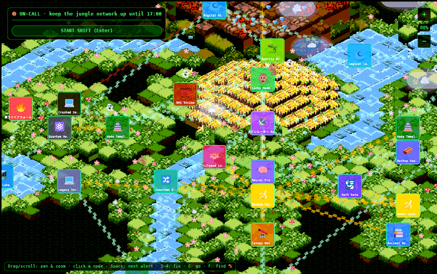

# Lucky Monkey

> *It is 09:00. You are the on-call monkey. Somewhere in the jungle a herd of
> nine thousand elephants is about to hit the banana cache, a worm is copying
> itself across the API vines, and the certificate on the Auth Gate expires
> in fifty seconds. The Watchtower can see some of it coming. Not all of it.*

**Lucky Monkey** is a browser game about keeping a make-believe jungle computer
network alive through one on-call shift. Underneath the jungle paint, it is
real systems thinking:

- The **routers, firewalls, databases, DNS, load balancers and monitoring** are
  nodes on an isometric map.
- Their **API connections** are vines with little data frames streaming along them.
- The trouble that hits them is the trouble that hits real production systems:
  [DDoS floods](failures.md#ddos_flood),
  [worms](failures.md#worm_infection),
  [replicas that disagree](failures.md#replica_disparity),
  and [deploys that can be rolled back, and deploys that cannot](failures.md#bad_deploy).

You run a crew (a monkey, a parrot, a sloth, a tree frog and an elephant), trace
each problem back to where it started, run the fix like a real command, and race
the big red **Time to Loss**. Some problems you can see
coming and prevent. Others you can only react to. And before any of that, you can
**tour the whole network** node by node, with its lore, or **practise** with no
pressure.

**▶ [Play it now](https://go.fridge.run/luckymonkey)**, or jump straight into a
situation:
- [a DDoS stampede on the Banana Cache](https://go.fridge.run/luckymonkey#node=banana-sector&incident=ddos&zoom=1.2)
- [a deploy that migrated the database](https://go.fridge.run/luckymonkey#node=main-router&incident=migration)
- [a certificate about to expire](https://go.fridge.run/luckymonkey#node=auth-gate&forecast=cert&zoom=1.3)

(These links open the game at that node with that problem already staged; see
[deep links](interface.md#deep_links).)

## Why it is interesting

- **It is a real game engine in a web page.** The whole thing is
  [Rust](https://www.rust-lang.org) compiled to [WebAssembly](https://webassembly.org),
  running the [Bevy](https://bevyengine.org) engine and drawing through
  [WebGL2](https://developer.mozilla.org/en-US/docs/Web/API/WebGL2RenderingContext).
  There is no JavaScript game code: the page loads two files and hands over a canvas.
- **The isometric world is tiny, clever maths.** One
  [three-line function](source/world.md#fn_iso) turns grid cells into screen
  pixels. Drawing each diagonal row of the map as a
  [single mesh](source/world.md#fn_spawn_terrain) makes tall terrain hide what is
  behind it correctly, with a few dozen draw items instead of thousands.
  [Read how](world.md).
- **The network is simulated, not painted.** Links are a graph. The monkey finds
  routes with [Dijkstra's algorithm](source/ops.md#fn_route) and cannot walk
  through a dead node. Failures spread to neighbours the way
  [cascading failures](https://en.wikipedia.org/wiki/Cascading_failure) do.
  [Read how](simulation.md).
- **It teaches the hard parts of being on call:**
  - prioritising with one pair of hands;
  - reading symptoms instead of guessing;
  - knowing when *not* to roll back;
  - valuing monitoring because you feel what it is like when it goes dark.

  [The failure guide](failures.md) explains each scenario in real-world terms,
  with links to the fridge's own
  [SRE](https://go.fridge.run/certs/t/sre) and
  [Security+](https://go.fridge.run/certs/t/secplus) courses.
- **It is built to be taken apart.** Everything is documented down to the
  function, the [source code is readable right here in the wiki](source/index.md),
  and there is a full [engine extraction report](extraction-report.md) for
  reusing the renderer in another app.

## Start here

| If you want to… | Read |
|---|---|
| See what it looks like before reading anything | [A tour in pictures](tour.md) |
| Know where it came from and how the pieces fit | [Overview and history](overview.md) |
| Play well | [How to play](gameplay.md) and [Failure types](failures.md) |
| Meet every node and its story | [Nodes and lore](nodes.md) |
| Know why the on-call loop works the way it does | [On-call design](oncall-design.md) |
| Understand the engine | [The engine: Bevy and ECS](engine.md), then [The world](world.md) |
| Understand the game logic | [The network simulation](simulation.md) |
| Change or extend it | [Extending](extending.md), [Build, deploy and test](build-deploy.md) |
| Reuse the renderer elsewhere | [Isometric engine extraction report](extraction-report.md) |
| Know what everything is, where it came from, and its licence | [Outside assets and dependencies](assets.md) |
| Know why things are the way they are | [Decisions and known issues](decisions.md) |
| Look up a term | [Glossary](glossary.md) |
| Read the code | [Source code](source/index.md) |

## The project at a glance

| | |
|---|---|
| Live | <https://go.fridge.run/luckymonkey> (public, no sign-in) |
| Code | `LuckyMonkey/luckymonkey` on GitHub (private); browsable in the wiki: [source](source/index.md) |
| Engine | Bevy 0.20 · Rust 2024 · wasm32 · WebGL2 ([details](engine.md)) |
| Size | about 5,900 lines of Rust in 11 files; 28 nodes on 8 floating islands, 18 fault types, 20 actions, a crew of 4 |
| Download | 6.7 MB compressed (the price of a full engine; [why](decisions.md)) |
| Hosting | a container on fridge's shared Next.js runtime behind Caddy ([Architecture](:dev:architecture), [Runtimes](:dev:runtimes), [fridge-next-runtime](:git:next-runtime:start)) |
| Built | on fridge, by [`tools/deploy.sh`](source/deploy-sh.md) ([Build, deploy and test](build-deploy.md)) |
| Sibling project | [HedgePets](https://go.fridge.run/hedgepets), a Godot creature game on the same server |
| Where this fits | [Developer home](:dev:start) · [Services](:dev:services) · [Repositories](:dev:repos) · [Applied practices](:dev:applied-practices) |
