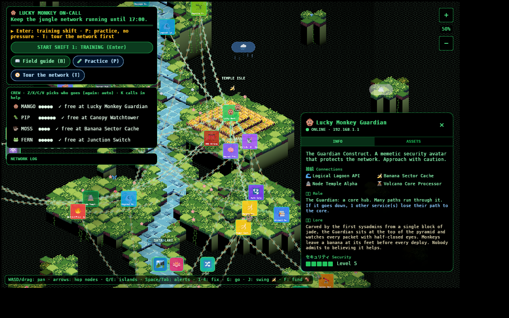
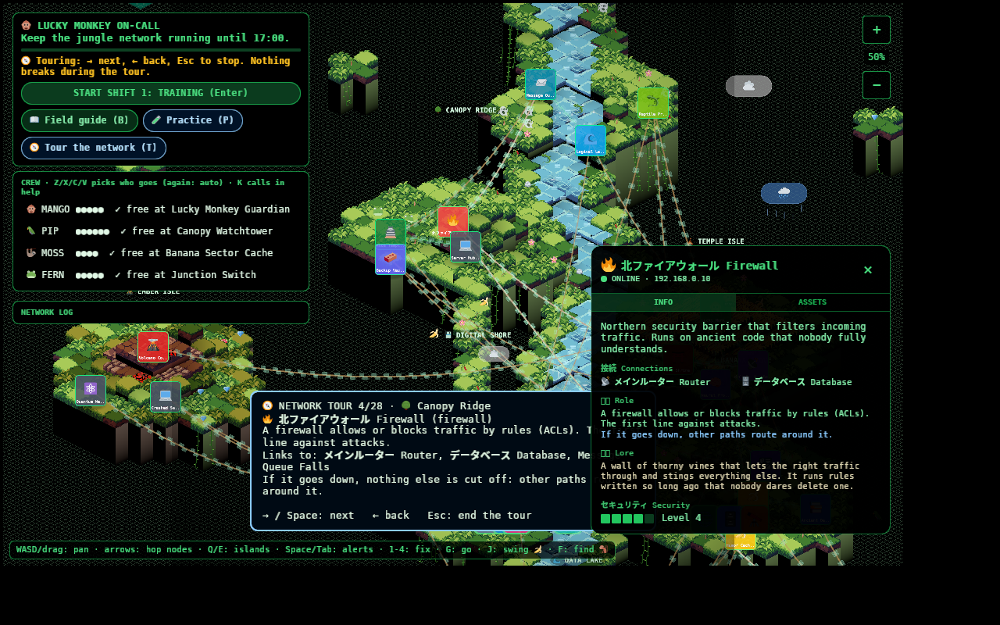
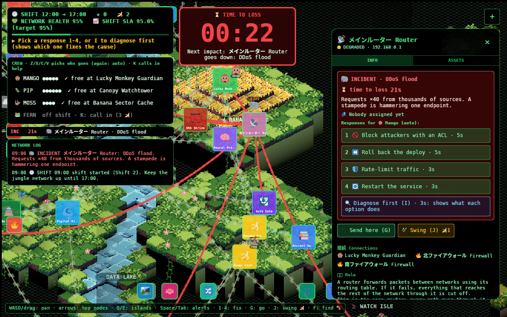
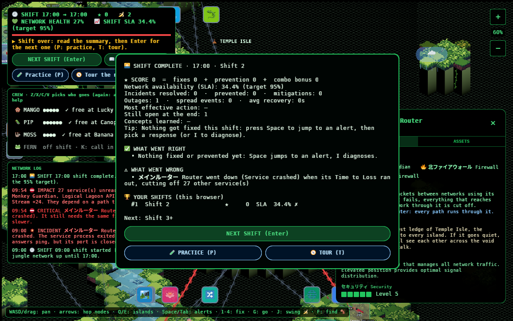

# On-call design pass

Why the game plays the way it does after the pacing/education pass, and where
each rule lives. Status: **live** at <https://go.fridge.run/luckymonkey> (deployed 2026-10-16).

## Architecture

| Layer | File | Notes |
|---|---|---|
| Simulation | `game/src/sim.rs` | No Bevy. Faults, director, workers, event log, SLA. Deterministic per seed. |
| Rules | `game/data/tuning.json` | Every fault, action, worker, level, tutorial step, concept, notice. Live-editable (`tools/deploy.sh data`). |
| Presentation + input | `game/src/ops.rs` | Steps the sim each frame, turns keys/clicks into orders, draws HUD and map overlays. |
| Node panel | `game/src/ui.rs` | Urgent block first (`ops::alert_box`), details after. |
| Tests + balancing | `game/simtest/` | Native crate that compiles `sim.rs` directly: `cargo test`, `cargo run --bin balance` (build on fridge). |

## Root causes vs dependency impacts

A fault lives on one node. Every recompute walks the graph from the core router
through nodes that aren't down; anything not reached is **unreachable**: an
impact, not a fault. It gets no incident, no repair, and recovers on its own
(one grouped "reachable again" log line) when the path returns. Unreachable
services count 30% toward network health (they still run locally).

## The incident director

New root causes appear only when all hold:
- the grace period after the last fix (15 s) is over;
- root causes still in play (warning/incident, not long-down outages) are under
  the level's budget (training 1→2, shift 2 1→3, shift 3+ 2→4 across the day);
- network health is above 60%.

Critical infrastructure is chosen less often (weight ÷ criticality) and never
in training. Worms and floods spread **once**, 30 s after their node goes down.
Lightning goes through the same budget. In calm periods the director posts
flavour notices (backups, cache hit ratios, DNS cache expiry) that teach
observation without demanding action.

Shift 1 is scripted: crash → DNS → certificate warning → two problems at once,
each step after the previous one is resolved plus the grace period.

## Time to Loss

The big timer shows the earliest consequence: a warning becoming an incident, an
incident taking its node down, a mitigation wearing off, or a spread. With none,
it shows **ALL CLEAR**. It is a game term, explained in the field guide as *not*
IP TTL (hop count) or DNS TTL (cache lifetime). The shift clock is separate.

## Crew

| | Moves | Good at | Can't |
|---|---|---|---|
| 🐵 Mango, monkey | walks the links (300 px/s), vine swing for 🍌 | everything, normal speed | — |
| 🦜 Pip, parrot | flies straight over the void (420 px/s) | diagnosis at 2× speed | heavy hands-on work |
| 🦥 Moss, sloth | slow walker (110 px/s) | preventive maintenance at 2× | — (other work 1.2× slower) |
| 🐸 Fern, tree frog | hops fast (360 px/s) | hardware at 2× (cables, vents, power) | — |

Each has stamina (jobs before a rest) and a queue of up to 3 jobs. Dispatch,
arrival, work, results and rests all go to the shared network log. Bananas are
only for exceptional moves: vine swing (1) and rally a resting worker (2).

## Responses

Each fault lists, per action: **fix** (root cause), **mitigate** (temporary, N
seconds, then the fault returns), or **none** (with the reason). Wrong choices
cost time and the combo, never a "WRONG" label. Diagnose (🔍) reveals what every
option does and teaches the concept.

## Balancing (20 seeds per row, bots)

Policies: Idle (never acts), Novice (guesses), Beginner (diagnoses first),
Expert (knows the fix, uses every worker). SLA target 95%.

| level | policy | done | SLA avg/min | roots | max open avg/worst | resolved | avg recovery |
|---|---|---|---|---|---|---|---|
| Practice | Idle | 20/20 | 97.9/94.2 | 2.3 | 2.3/3 | 0 | — |
| Practice | Expert | 20/20 | 99.8/99.8 | 16.1 | 1.0/1 | 7.4 | 8 s |
| Shift 1 | Idle | 20/20 | 91.6/91.6 | 5.0 | 5.0/5 | 0 | — |
| Shift 1 | Novice | 20/20 | 99.6/99.4 | 12.6 | 2.0/2 | 6.2 | 25 s |
| Shift 1 | Expert | 20/20 | 99.8/99.7 | 15.1 | 2.0/2 | 7.8 | 8 s |
| Shift 2 | Idle | 20/20 | 92.2/85.9 | 8.1 | 9.0/11 | 0 | — |
| Shift 2 | Novice | 20/20 | 99.5/99.3 | 14.2 | 2.0/2 | 6.4 | 28 s |
| Shift 2 | Expert | 20/20 | 99.8/99.6 | 17.6 | 1.0/1 | 9.3 | 9 s |
| Shift 3+ | Idle | 18/20 | 77.5/39.9 | 12.6 | 14.1/18 | 0 | — |
| Shift 3+ | Novice | 20/20 | 99.1/97.8 | 18.9 | 3.0/5 | 10.0 | 31 s |
| Shift 3+ | Expert | 20/20 | 99.7/99.6 | 20.4 | 1.2/2 | 11.9 | 8 s |

Reading it: ignoring the network misses the target at every level and collapses
some shift-3 runs; any engaged player stays well above it. Skill shows in score,
recovery time and prevention more than in SLA: the bots react within seconds,
humans won't, so real SLAs will be lower.

## Second pass: learning, ropes, crews, game over

- **Tour the network (T)** outside shifts: steps through every node island by
  island with its role in plain words, what it links to, and how many services
  would lose their path if it went down (`Sim::impact_if_down`). Nothing breaks
  during the tour. Every node has lore (`nodes.json` → `lore`) and a role
  (`tuning.json` → `roles`) in its panel.
- **Practice (P)**: level 0, one problem at a time, 3× longer timers, no
  spreading, no early end, full crew. It doesn't move you up a level.
- **Crew per scenario**: each level lists its `crew` (training: Mango + Pip; shift
  2: + Moss; shift 3+: + Fern 🐸, a hardware specialist). Off-shift workers can be
  called in mid-shift for `call_cost` bananas (K).
- **Ropes**: links between islands are drawn as slack ropes (quadratic sag, 14
  pieces, frames ride the curve), visible at rest. Any link touching a live
  incident turns bright red, 5 px, fully opaque.
- **Time to Loss** is a big red 56 px timer on a dark red plate for incidents,
  amber for warnings, a small green ALL CLEAR otherwise.
- **Game over / shift summary**: score breakdown (fixes + prevention + combo),
  what went right and what went wrong (specific notes recorded during play), a tip,
  and this browser's shift history (`localStorage`, last 20). Levels advance only
  when the SLA target is met.
- **Readability**: dark plates behind map text (countdowns, popups, worker
  names, island names); panels are opaque, scroll with the wheel and fit the screen.
- **Verticality**: island heights 1-9, stepped hills per island
  (`islands.json` → `hills`), taller islets; the river cuts canyons where the
  ground is higher than the water. The background grid is 2.4× larger.

