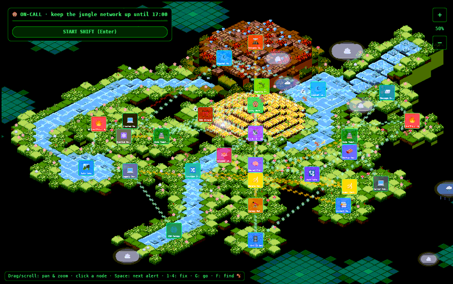

# Overview and history

## The idea

Most games about computers are about hacking into them. Lucky Monkey is about the
opposite and much more common job: **keeping them up.** On-call engineers spend
their shifts reading symptoms, guessing less than they would like, choosing between
remedies that each make some problems better and others worse, and deciding what
to look at first when three things break at once.

The game turns that into something you can play in a lunch break:

- **The network is a jungle.** 28 nodes ([the full list](assets.md#what_is_whatthe_nodes))
  sit on terrain islands floating in a dark void: a router (📡), firewalls (🔥),
  a database (🗄️), a DNS shrine (⛩️), a load balancer standing on lily pads in the
  river (🪷), a monitoring watchtower (🔭), a temple pyramid with the Lucky Monkey
  Guardian on top (🐵).
- **The API connections are vines.** Little data frames stream along every link,
  both ways ([how](world.md#the_river_and_the_links)).
- **The rivers are data too.** Frames float down the main river and the
  *Digital River*, which ends in the *Data Lake* ([how](world.md#the_rivers)).
- **The weather is a hazard.** Storm clouds flash yellow and can knock a node's
  power out ([how](world.md#clouds)).
- **You run a crew** (🐵 🦜 🦥 🐸). They walk or fly the links, and every fix takes time.
  ([How to play](gameplay.md).)

## History: three renderers in three weeks

Each step is one commit in the repository.

| Date | Commit | What happened |
|---|---|---|
| 2026-09-24 | `9e35d5d` | **The original export** from [v0.dev](https://v0.dev), an AI tool that generates React/Next.js apps. A Next.js site that drew the map out of HTML elements, with floating cloud `
`s that had rounded borders, a cloud emoji inside and a yellow flash for storms. Kept untouched as a baseline. |
| 2026-09-24 | `a10d835` | **Cleaned up and sped up:** v0 scaffolding removed, hidden type errors fixed, a faster renderer using [Pixi.js](https://pixijs.com) (a 2D WebGL drawing library), moved onto the shared [fridge-next runtime](:git:next-runtime:start). This was version 0.2. |
| 2026-10-15 | `182ece0` | **Ported to Bevy.** Rust compiled to WebAssembly; Next.js now only hosts the canvas. Two visual bugs the owner disliked were fixed on the way: tiles that never lined up, and a pyramid built upside down ([Decisions](decisions.md#bugs_found_and_fixed_in_the_port)). |
| 2026-10-15 | `579f0f6` | **First game loop** (a turn-based quiz), water animations, river banks, and the old-style clouds back after the owner said the new realistic ones "lost the charm". |
| 2026-10-16 | `oncall` | **On-call:** the sim split out of Bevy, an incident director, a crew of four, Time to Loss, root causes vs impacts, mitigation vs fix, training/practice/tour, node lore, the archipelago with one river and rope links, game-over notes and shift history. |
| 2026-10-15 | `48ca8d3` | **Game loop v2:** the walking monkey, timed fixes, TTL countdowns, Watchtower forecasts, frame streams, the Digital River continued into the Data Lake, and seven new places. |
| 2026-10-15 | `88608ff` | **Deep links:** URLs that open the game at a node with a problem staged, used all over these docs. |

### Why move to a game engine?

The owner wanted a real game with a game loop, not a web page. Pixi.js is a
drawing library: game logic, input, state, UI and timing were all hand-rolled in
React around it, and React re-renders fought the animation.
[Bevy](https://bevyengine.org) is a whole engine with those parts built in. Its
[entity-component-system design](engine.md#ecs_in_five_minutes) suits a simulation
with thousands of small moving things.

The costs were known up front:
- a large download (6.7 MB compressed);
- long compile times (30+ minutes from cold), which is why the
  [build happens on fridge](build-deploy.md#why_the_build_happens_on_fridge).

## How the pieces fit

    browser
      │  https://go.fridge.run/luckymonkey
      ▼
    fridge-caddy (reverse proxy, TLS)                         see :dev:architecture
      │  /luckymonkey
      ▼
    container "luckymonkey" (image fridge-next:14, read-only)   see :dev:runtimes
      │  serves app/page.tsx → a page with one <canvas id="lm-canvas">
      │  serves public/game/luckymonkey.js + luckymonkey_bg.wasm
      ▼
    browser runs the wasm: Bevy draws into the canvas with WebGL2

- **Reverse proxy:** [fridge-caddy](:dev:architecture) routes `go.fridge.run/luckymonkey`
  to the container.
- **The page:** [`app/page.tsx`](source/page-tsx.md) checks the browser has WebGL2,
  then dynamically imports `luckymonkey.js`. That file is JavaScript glue generated
  by [wasm-bindgen](https://github.com/wasm-bindgen/wasm-bindgen); it fetches and
  starts the 28 MB `luckymonkey_bg.wasm`.
- **After that, everything on screen is Bevy.** The app is assembled in
  [`fn main`](source/main.md#fn_main) ([Engine](engine.md)).
- **No assets are fetched at runtime.** The map data, textures and fonts are
  compiled into the wasm with `include_bytes!` ([`fn load_art`](source/main.md#fn_load_art)).
  So the game cannot half-load, and the server only ever serves two files.

## Repository layout

| Path | What | Read it |
|---|---|---|
| `game/src/main.rs` | app setup, shared fonts and textures, random generator | [source](source/main.md) |
| `game/src/world.rs` | isometric maths, terrain meshes, decorations, node cards | [source](source/world.md) · [explained](world.md) |
| `game/src/water.rs` | waterfall, bubbles, glints, river frames | [source](source/water.md) |
| `game/src/clouds.rs` | clouds, rain, lightning | [source](source/clouds.md) |
| `game/src/npc.rs` | wandering critters | [source](source/npc.md) |
| `game/src/view.rs` | camera, input, picking | [source](source/view.md) · [explained](interface.md#camera) |
| `game/src/ui.rs` | welcome screen, node panel, zoom buttons | [source](source/ui.md) |
| `game/src/sim.rs` | **the rules**: faults, director, crew, health, scoring (no Bevy; tested natively) | [source](source/sim.md) · [explained](simulation.md) |
| `game/src/ops.rs` | **the game screen**: HUD, Time to Loss, map overlays, edge pins, input → orders | [source](source/ops.md) |
| `game/src/data.rs` | live JSON loading with built-in fallbacks | [source](source/data.md) |
| `game/data/*.json` | every rule, number, island and node: [live data](build-deploy.md#live_data) | [nodes](nodes.md) · [faults](failures.md) |
| `game/simtest/` | rule tests + balancing bots | [testing](build-deploy.md#testing) |
| `game/src/link.rs` | deep links from the URL hash | [source](source/link.md) |
| `game/Cargo.toml` | Rust crate: Bevy features, release profile | [source](source/cargo-toml.md) |
| `lib/world-data.ts` | **the map source** (TypeScript generators) | [source](source/world-data.md) · [explained](world.md#from_typescript_to_the_wasmthe_map_s_journey) |
| `tools/*` | export, textures, deploy, fonts, browser test, these source pages | [deploy](source/deploy-sh.md) · [textures](source/make-textures.md) · [export](source/export-world.md) |
| `app/page.tsx` | host page | [source](source/page-tsx.md) |
| `public/sprites/` | the original 32 px tile pictures | [assets](assets.md#images) |
| `docs/` | these pages | |

**Generated but committed:** `game/assets/world.json`, `npcs.json`, `tiles.png`,
`card*.png`. They are rebuilt by the tools on every deploy, but kept in git so the
Rust crate builds without Node or Python.

Next: [How to play](gameplay.md) · Back to the [documentation](index.md)
