# A tour in pictures

Every picture here was taken from the live game by opening a
[deep link](interface.md#deep_links). Click **▶ live** under any picture to
open the game at exactly that spot, in your browser, right now. (The game
downloads about 6.7 MB the first time.)

## The on-call jungle (current)

The archipelago as it is now: separate floating islands at different heights,
one river from void to void, rope links between islands.

**Tour mode (T)** walks you through every node with its role, links and lore:

An incident: the big red **Time to Loss**, red links to the troubled node, the crew
roster and the shared network log:

When the main router goes down, everything behind it goes **unreachable**: an
impact, not a fault of its own.

Diagnose first and the panel tells you what each option would do; the field guide
keeps every concept you've met:

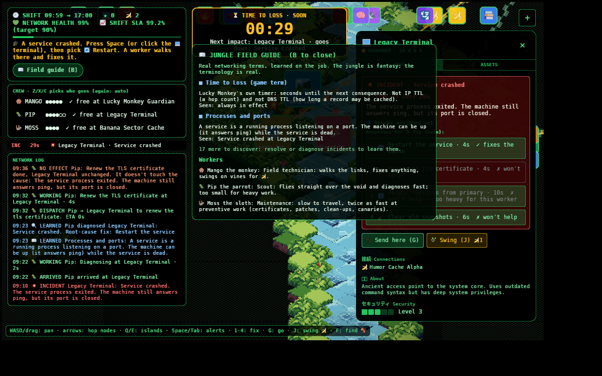

Pixel vines hang from the island edges:

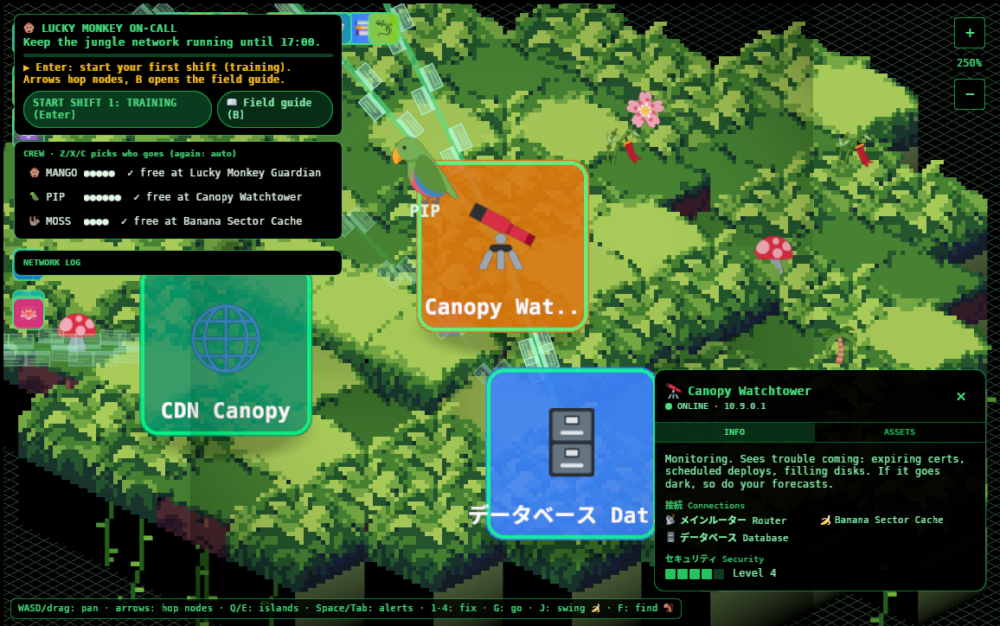

And the end of the shift tells you what went right, what went wrong, and your score:

## Earlier pictures

The pictures below are from before the archipelago (one landmass, single monkey,
Watchtower forecasts). The places still exist, and the ▶ live links still open them.

### The whole jungle

The world is a set of terrain islands floating in a dark void. The void is a
[tiled grid pattern](source/world.md#fn_spawn_backdrop) with faint teal
[edge islands](source/world.md#fn_spawn_islands) hinting at more network beyond.
The coloured cards are the 28 [nodes](assets.md#what_is_whatthe_nodes). The pale
dashes between them are [data frames streaming along the links](world.md#the_river_and_the_links).
▶ [live](https://go.fridge.run/luckymonkey#zoom=0.5)

### The Guardian's pyramid

The Lucky Monkey Guardian sits on a stepped golden temple at the centre of the
network. The map generator originally built this pyramid **upside down** (the
widest layer was the highest). The loader [rebuilds it](source/world.md#fn_plugin)
so that the more layers cover a cell, the higher it stands. See
[Decisions](decisions.md#bugs_found_and_fixed_in_the_port).
▶ [live](https://go.fridge.run/luckymonkey#node=monkey-statue&zoom=1.1)

### The waterfall and the Message Queue Falls

The main river starts at a waterfall that steps down five levels. White streams
pour over each step: three [streaks per tile](source/water.md#fn_spawn) restored from the
original canvas animation (see [water effects](world.md#water_effects)). Messages
wait at the top of the falls and drop one at a time, in order. Usually.
▶ [live](https://go.fridge.run/luckymonkey#node=mq-falls&zoom=1.6)

### The Logical Lagoon

Bubbles rise and pop in the lagoon (the original CSS `bubble` keyframes,
re-done in [`water.rs`](source/water.md#fn_animate)). The little boxes floating
on the water are **data frames**: the rivers carry data downstream.
▶ [live](https://go.fridge.run/luckymonkey#node=logical-lagoon&zoom=1.8)

### The Data Lake

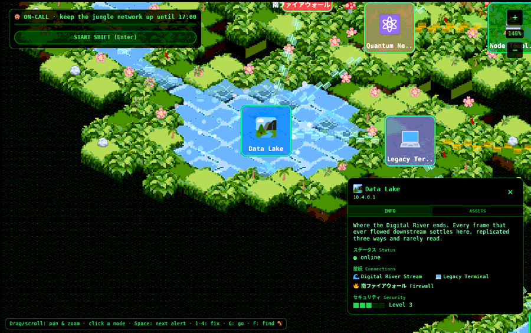

The Digital River runs down the west edge of the map and ends here. Every frame
that ever flowed downstream settles in the Data Lake, "replicated three ways and
rarely read". Data stores like this one suffer
[replica disparity](failures.md#replica_disparity) and [full disks](failures.md#disk_full).
▶ [live](https://go.fridge.run/luckymonkey#node=data-lake&zoom=1.4)

### The volcano

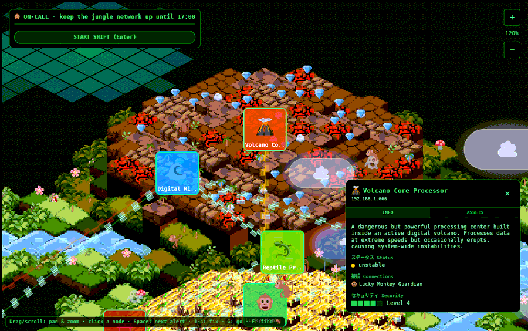

The Volcano Core Processor: "processes data at extreme speeds but occasionally
erupts". Its platform is lava tiles from the [atlas](world.md#tiles_and_the_alignment_bug_that_started_it_all);
the crystals are emoji decorations.
▶ [live](https://go.fridge.run/luckymonkey#node=volcano-core&zoom=1.2)

### The Lilypad Load Balancer

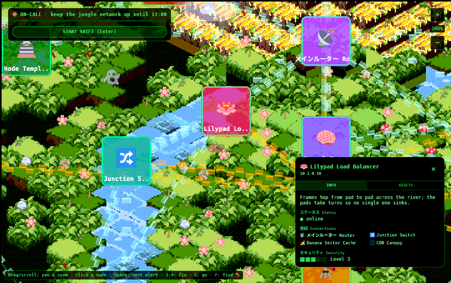

A load balancer standing in the river: "frames hop from pad to pad; the pads
take turns so no single one sinks". It is one of
[seven places added](overview.md#historythree_renderers_in_three_weeks) so the network reads like real
infrastructure.
▶ [live](https://go.fridge.run/luckymonkey#node=lb-lilypads&zoom=1.6)

### The DNS Shrine

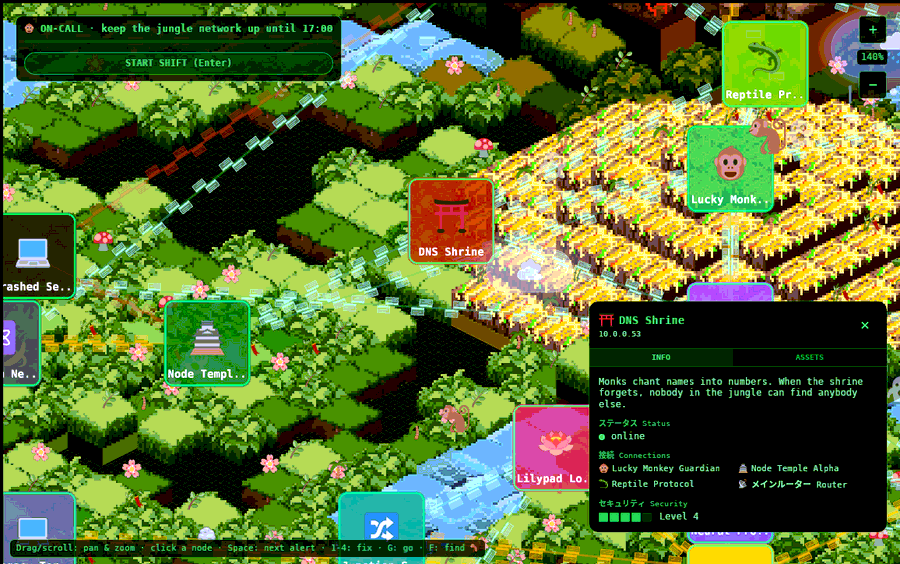

"Monks chant names into numbers. When the shrine forgets, nobody in the jungle
can find anybody else." ([What DNS is](https://en.wikipedia.org/wiki/Domain_Name_System);
the fridge's [Network+ lesson on the services every network runs](https://go.fridge.run/certs/learn/netplus?n=4).)
▶ [live](https://go.fridge.run/luckymonkey#node=dns-shrine&zoom=1.4)

### The Canopy Watchtower

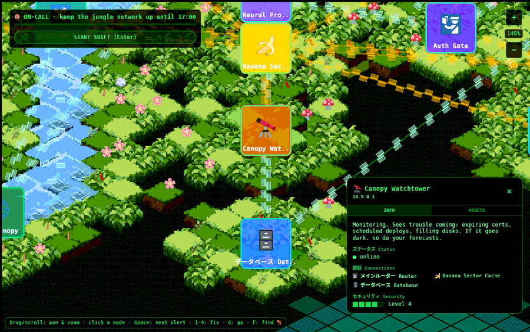

Monitoring. While the Watchtower is up, you get **forecasts** of trouble before it
happens. If it goes down, the forecasts vanish and you fly blind. See
[forecasts](gameplay.md#trouble).
▶ [live](https://go.fridge.run/luckymonkey#node=watchtower&zoom=1.4)

### Trouble: a DDoS stampede

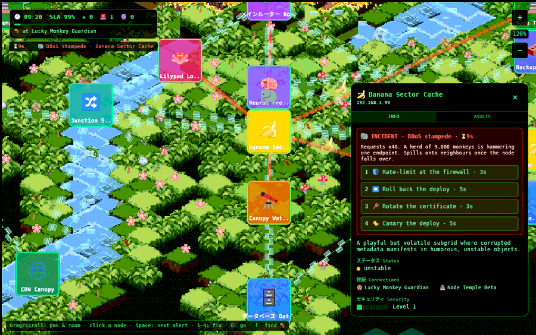

Every link into the victim fills with fast red frames heading in: the flood made
visible ([the code](source/ops.md#fn_frames)). The panel shows the symptoms and
four possible fixes. One is right. Which one, and why, is in the
[failure guide](failures.md#ddos_flood).
▶ [live](https://go.fridge.run/luckymonkey#node=banana-sector&incident=ddos&zoom=1.2)

### Trouble you can see coming: a forecast

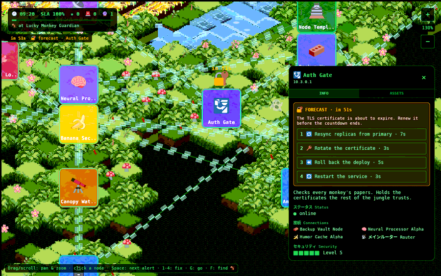

An amber **forecast** from the Watchtower: the Auth Gate's certificate is about to
expire. Nothing is broken yet. Rotate it before the countdown ends and the outage
never happens, and you score more than you would for fixing it afterwards.
▶ [live](https://go.fridge.run/luckymonkey#node=auth-gate&forecast=cert&zoom=1.3)

### Trouble that tests you: a deploy with a migration

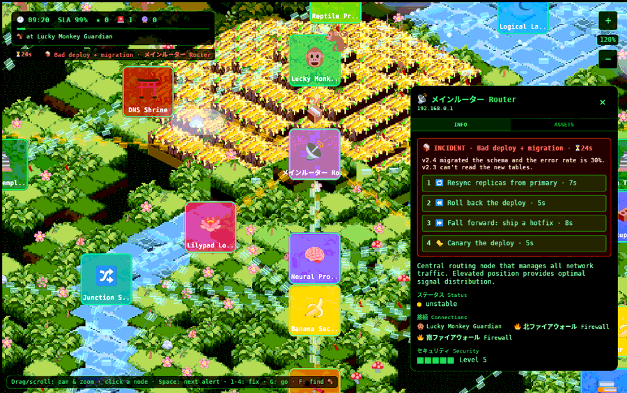

Both *Roll back* and *Fall forward* are always offered for a bad deploy. Read the
symptom: this deploy **migrated the schema**, so the old version cannot read the
new tables, and rolling back would make things worse. This is the lesson the
owner asked for ("fall forward").
[Why](failures.md#bad_deploy).
▶ [live](https://go.fridge.run/luckymonkey#node=main-router&incident=migration)

### Trouble with data: replica disparity

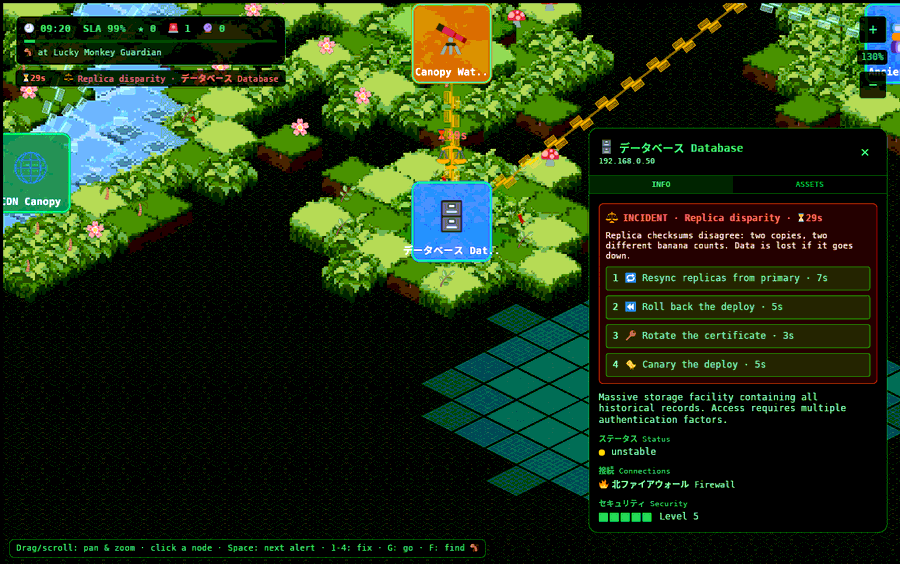

Two copies of the data, two different banana counts. Resync from the primary
before the countdown ends, or the data is lost for good (and the SLA takes an extra hit).
▶ [live](https://go.fridge.run/luckymonkey#node=database-cluster&incident=disparity&zoom=1.3)

Next: [Overview and history](overview.md) · Back to the [documentation](index.md)
