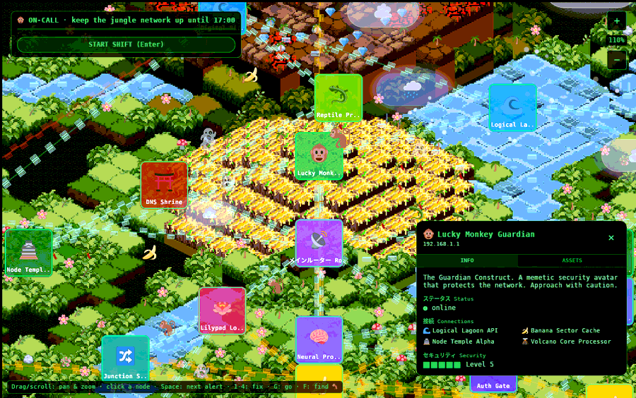
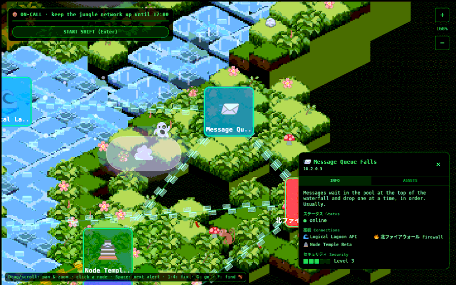
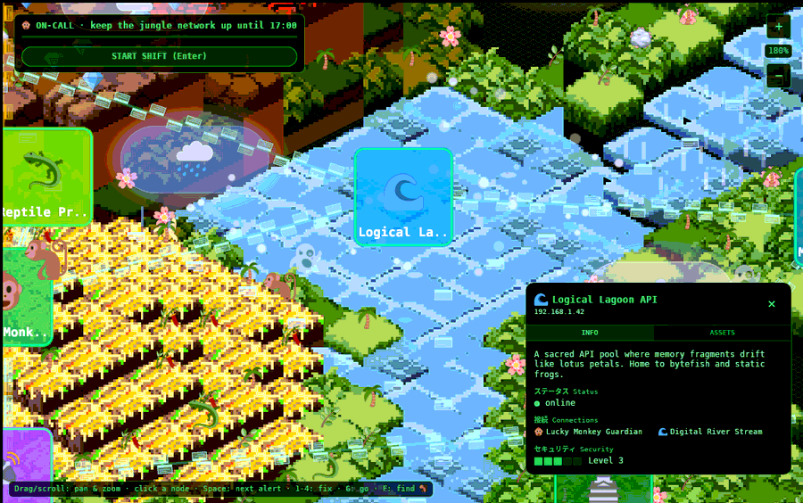

# The world

> How 1,100 little blocks of grass, water and lava become a jungle floating in
> the void: the data, the maths, and the tricks.



## The archipelago


The map is **data you can edit**: [`game/data/islands.json`](build-deploy.md#live_data)
places the islands and [`nodes.json`](nodes.md) defines the nodes.
`tools/gen-world.py` turns them into `world.json` (tiles, nodes, decorations,
streams) in about a second, and `tools/deploy.sh data` puts it live without a
Rust build.

- **One river, void to void.** It falls in from the void at the top (height 11),
  runs through Lagoon Heights, Canopy Ridge, Temple Isle, Digital Shore, Banana
  Grove and the Data Lake, and spills off the far edge (height 0). Where an island
  is higher than the water, the river cuts a **canyon**.
- **Two vine bridges** join island pairs (Temple ↔ Banana, Canopy ↔ Shore).
- **Two free-floating islands**, Ember Isle 🌋 and Watch Isle 🔭, touch nothing.
  Their links reach them as ropes across the void.
- **Verticality:** island heights 1 to 9 with stepped `hills`, and small islets
  up to height 9, so the islands read as separate floating masses.
- **Nodes** are placed by offsets from their island's centre. One that lands on
  water or void is nudged to the nearest bank.
- **Pixel vines** hang from exposed grass, platform and temple edges, clustered by
  a hash and kept clear of the nodes.
- The generator's seed is **8675309**, so the same JSON always gives the same world.

The node lore and the per-island list are in [Nodes and lore](nodes.md).

**History:** the map used to come from the original TypeScript generators
(`lib/world-data.ts` via `tools/export-world.cjs`), with load-time repairs for an
upside-down pyramid and a river that floated in the void. The owner wanted
separate floating islands joined by jungle and river, so the map became data.
`world.json` carries `baked: true` and the old repairs are skipped.

## The isometric maths

The whole projection is one function, [`fn iso`](source/world.md#fn_iso):

```rust
pub fn iso(x: f32, y: f32, h: f32) -> Vec2 {
    Vec2::new((x - y) * TILE_W / 2.0, -((x + y) * TILE_H / 2.0) + h * ELEV)
}
```

With `TILE_W = 64`, `TILE_H = 32` and `ELEV = 16`:
- a tile's top is a 64×32 diamond (the classic 2:1 isometric ratio);
- each unit of height lifts it 16 px;
- Bevy's y axis points up, hence the minus.

**Worked example:** the Guardian on the pyramid summit at grid (17, 17), height 5:
x = (17−17)·32 = 0, y = −(34)·16 + 5·16 = **−464**. A classic explanation of the
idea: [Isometric tiles math](https://clintbellanger.net/articles/isometric_math/).
The reverse (screen → grid) is worked out in the
[extraction report §4](extraction-report.md#world_grid_inverse).

## Tiles, and the alignment bug that started it all



The tile pictures ([`public/sprites/*.png`](assets.md#images)) are **32×32
isometric blocks**: the top diamond fills rows 8-24, and an 8 px side "skirt"
hangs below.

[`tools/make-textures.py`](source/make-textures.md) packs the 15 sprites plus one
white cell into a single 4×4 [texture atlas](https://en.wikipedia.org/wiki/Texture_atlas)
(`tiles.png`, 136×136):
- each 32 px cell is padded to 34 px by copying its edge pixels outwards, so a
  neighbour never bleeds in when the GPU samples at a cell's edge;
- [`fn cell_uv`](source/world.md#fn_cell_uv) finds a cell's coordinates in the atlas;
- [`fn atlas_cell`](source/world.md#fn_atlas_cell) picks a variant per cell with a
  stable hash ([`fn cell_hash`](source/world.md#fn_cell_hash)), so the same cell
  always gets the same grass.

The sprites are drawn **at 2×** (64×64), so the diamond lands exactly on the
64×32 grid cell. **The old Pixi.js version squashed them into 64×32 rectangles**,
which distorted every diamond so the tiles never met. That was the "tile alignment"
problem the owner wanted fixed, and fixing it properly was part of the case for
the port.

Tile kinds ([`mod kind`](source/world.md#mod_kind)): grass (4 variants), water (5),
platform (tinted grass), scorched (tinted), volcano/lava (5), temple gold.

## The terrain mesh

[`fn spawn_terrain`](source/world.md#fn_spawn_terrain) builds one mesh per diagonal
row (x + y) using a small vertex buffer helper, [`MeshBuf`](source/world.md#struct_meshbuf).
For each cell it adds:

- **Two front walls**, one for each visible side. Each drops to the neighbour in
  front, or down to the bottom of the island slab (one unit below the ground) when
  there is no neighbour. Walls are vertex-coloured by kind
  ([`fn wall_color`](source/world.md#fn_wall_color)), and the left wall is drawn
  darker, which reads as light coming from the right.
- **The top sprite**, as a quad textured from the atlas.

Taller tiles are tinted slightly brighter ([`fn top_tint`](source/world.md#fn_top_tint)),
so terraces read at a glance. Then each row's mesh is placed at z = x + y.
[Why that works](engine.md#renderingdepth_in_a_2d_isometric_world).

## The river and the links

The river's centreline is exported as `streams`, and data frames float down it.
The **links between nodes** are drawn on top of the world
([`fn spawn_overlay`](source/ops.md#fn_spawn_overlay)):

- links inside an island are straight; links **between islands are slack ropes**
  ([`fn curve`](source/ops.md#fn_curve): a quadratic sag, 14 segments), tan at 70%
  opacity, so the archipelago reads as islands strung together;
- data frames ride along each link's curve;
- a link touching a live incident turns **bright red, 5 px, fully opaque**
  ([`fn links`](source/ops.md#fn_links)), so you can see the trouble from across the map.

## Water effects



[`water.rs`](source/water.md) restores the original v0 canvas animation:

| Effect | What it does | Code |
|---|---|---|
| Waterfall streams | three white streaks per waterfall tile pour down once a second | [`fn spawn`](source/water.md#fn_spawn), [`fn animate`](source/water.md#fn_animate) |
| Lagoon bubbles | on 60% of lagoon tiles, two bubbles rise 20 px and pop over 3 s (the original CSS `bubble` keyframes), wobbling | [`fn animate`](source/water.md#fn_animate) |
| Glints | small white flashes on 30% of river tiles, each with its own rhythm | [`fn animate`](source/water.md#fn_animate) |
| **Data frames on the rivers** | a frame every 46 px of river, floating downstream at 38 px/s, bobbing, fading in at the source and out at the mouth; depth recomputed every frame so frames slip behind banks | [`struct Line`](source/water.md#struct_line), [`fn flow`](source/water.md#fn_flow) |

## Decorations, edge islands and the void

- **Decorations** are emoji rendered as text
  ([`fn spawn_decorations`](source/world.md#fn_spawn_decorations),
  [`fn emoji_text`](source/world.md#fn_emoji_text)): 🌴 🌸 🌿 💎 🎋 🍄 🪷 🪨.
  Lotus grows only on water and everything else only on land. A small hashed jitter
  stops them sitting in a perfect grid.
- **Islets:** small floating rocks scattered between the islands, some with a tree.
- **The void:** `grid_background.png` is tiled behind everything at 35% opacity, drawn large
  (each tile 0.6 of its size in world units) so it reads as a distant grid, not fine noise
  ([`fn spawn_backdrop`](source/world.md#fn_spawn_backdrop)).

## Node cards

Each node is an 80×80 rounded card ([`fn spawn_nodes`](source/world.md#fn_spawn_nodes)):
- a `card.png` tinted by node type ([`fn node_color`](source/world.md#fn_node_color));
- a green outline;
- its emoji;
- a name label, cut to 10 characters plus "..".

It stands at the node's ground height. The game adds an alert badge and countdown
as children ([Simulation](world.md#the_river_and_the_links)). Card
colour follows health: normal, pulsing amber (unstable), dark red-brown (down).

## Critters

[`npc.rs`](source/npc.md): 26 critters from the roster.

- **Movement:** logic ticks every **80 ms**, as in the original
  ([`fn tick`](source/npc.md#fn_tick)). Each tick a critter steps in one of eight
  directions, turns around at the map edge or impassable terrain, and sometimes
  picks a new heading (monkeys 2%, lizards 3%, ghosts and bananas 5%, crocodiles 1%).
- **Where they go:** lizards and crocodiles stay on water; bananas go anywhere.
- **Smooth motion:** between ticks, the sprite glides toward its logical position
  ([`fn place`](source/npc.md#fn_place)).
- **Lifespan:** each fades in, lives 30, 60 or 90 s, then fades out. Up to 20 are
  alive at once.
- **Style:** ghosts bob and pulse translucent; bananas bounce.

## Clouds

Ten clouds: fair ☁️, rain 🌧️ and storm ⛈️. They are drawn like the original HTML
`<div>`s the owner liked: a translucent rounded **pill** with a 1 px border and the
emoji inside, in three sizes (80×40, 120×55, 160×75).

- They drift on one wind (right and slightly down) at 10-24 px/s and wrap around,
  so the sky never empties ([`fn drift`](source/clouds.md#fn_drift)).
- Rain clouds drop five streaks: the original `rain-drop` keyframes
  ([`fn rain`](source/clouds.md#fn_rain)).
- Storm clouds flash every 4-9 s ([`fn storm`](source/clouds.md#fn_storm)). Over
  0.6 s the pill itself ramps to yellow and ⚡ appears (no glow: the owner preferred the plain pill).
  At the peak a [`Strike`](source/clouds.md#struct_strike) message goes out, which
  [can knock out a node](failures.md#lightning).

**Their history is a small saga.** The port first replaced the divs with
"realistic" textured clouds with ground shadows. The owner said those lost the
charm, so the pill style came back as Bevy UI nodes, which broke the HUD's
rendering. Then they became world sprites. See [Decisions](decisions.md#design_decisions).

Next: [The network simulation](simulation.md) · Back to the [documentation](index.md)
